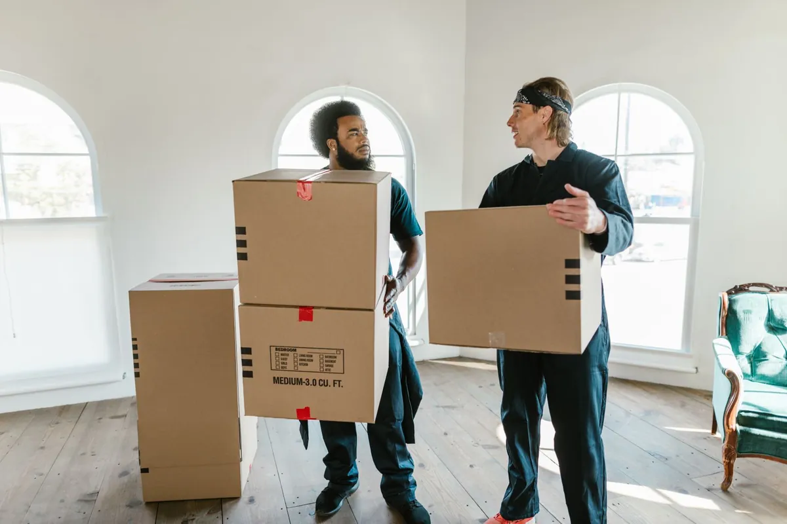
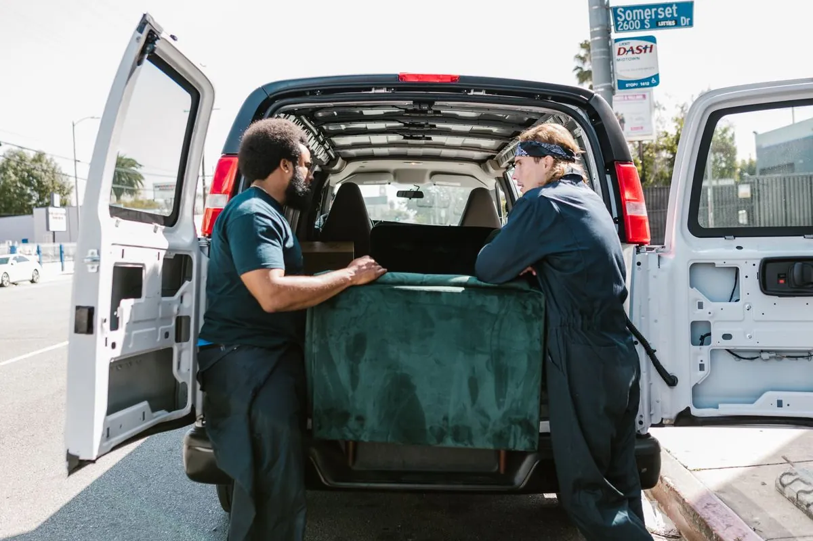

<strong>Direct answer:</strong> A typical 2-bedroom local move in the USA costs about $1,240, with a sample range of $843 to $1,637. Use the <a href="{{ '/movers-cost-calculator/' | relative_url }}">Movers Cost Calculator</a> to price your own move.

All prices on this page are sample estimated USA ranges, not quotes. Your real price depends on your home size, distance, and the mover you hire.

Key facts

<ul>
<li>A typical 2-bedroom local move costs about $1,240, with a sample range of $843 to $1,637.</li>
<li>A long distance move of 100 to 500 miles costs about 2.1 times the local price, so a 2-bedroom move is about $2,604.</li>
<li>Released value cover pays $0.60 per pound per item, while full-value protection costs about 1% to 2% of the declared value.</li>
<li>Book 4 to 6 weeks ahead for most moves, and 8 weeks ahead in summer.</li>
<li>Move mid-week, declutter first, pack yourself, and get 3 written quotes.</li>
</ul>

## How much do movers cost for a local move?

Swipe to see the High column &rarr;

  

<table class="cost-table">

<thead>
<tr><th>Home size</th><th>Local move (typical)</th><th>Long distance, 100 to 500 miles (estimate)</th></tr>
</thead>
<tbody>
<tr><td>Studio</td><td>$750</td><td>$1,575</td></tr>
<tr><td>1 bedroom</td><td>$950</td><td>$1,995</td></tr>
<tr><td>2 bedrooms</td><td>$1,240</td><td>$2,604</td></tr>
<tr><td>3 bedrooms</td><td>$1,750</td><td>$3,675</td></tr>
<tr><td>4+ bedrooms</td><td>$2,300</td><td>$4,830</td></tr>
</tbody>
</table>

Long distance costs about 2.1 times the local price in these sample ranges. For example, $1,240 times 2.1 equals $2,604 for a 2-bedroom move of 100 to 500 miles. For a 1 bedroom apartment, movers cost about $950 typical for a local move, with a long distance estimate of $1,995 for 100 to 500 miles.

Survey data tells a similar story. <a href="https://www.angi.com/articles/how-much-does-it-cost-hire-movers.htm" target="_blank" rel="noopener">Angi</a> reports a national average of $1,694, with most people paying $875 to $2,546 for a local move, based on 6,434 verified projects. A This Old House 2025 survey of 1,000 customers found a local average of $1,489, a long distance average of $3,129, and an overall average of $3,020.

<figure></figure>

## Long distance cost by weight

Long distance movers often price by weight as well as distance. <a href="https://www.angi.com/articles/how-much-does-it-cost-hire-movers.htm" target="_blank" rel="noopener">Angi</a> reports $0.50 to $0.80 per pound, and FindMoversNow reports $0.55 to $0.90 per pound, so a combined range of $0.50 to $0.90 per pound covers both sources. The worked line below uses that combined range.

<ul>
<li>7,000 pounds at $0.50 per pound = $3,500</li>
<li>7,000 pounds at $0.90 per pound = $6,300</li>
</ul>

Ask the mover for the estimated weight on the written quote, because the weight is what sets the final price on a weight based move.

## Specialty item costs

Some items need a specialist crew or extra equipment, and they are priced on top of the main move. Piano movers cost $260 to $580, per Angi, and the other ranges below are from Angi too.

Swipe to see the range &rarr;

  

<table class="cost-table">

<thead>
<tr><th>Item</th><th>Cost range</th></tr>
</thead>
<tbody>
<tr><td>Piano</td><td>$260 to $580</td></tr>
<tr><td>Pool table</td><td>$375 to $1,500</td></tr>
<tr><td>Hot tub</td><td>$300 to $1,200</td></tr>
<tr><td>Car</td><td>$1,000 to $2,000</td></tr>
</tbody>
</table>

## Moving insurance: released value vs full-value protection

Every interstate mover must offer released value coverage, and most also sell full-value protection. The two work very differently, so check which one is on your quote.

Swipe to see the cover &rarr;

  

<table class="cost-table prose-last">

<thead>
<tr><th>Cover</th><th>What it pays</th><th>Cost</th></tr>
</thead>
<tbody>
<tr><td>Released value</td><td>$0.60 per pound per item, so a 100 pound item pays $60</td><td>Included in the basic price</td></tr>
<tr><td>Full-value protection</td><td>Repair, replacement, or cash value of the item</td><td>About 1% to 2% of the declared value, so $50,000 of cover costs about $500 to $1,000</td></tr>
</tbody>
</table>

Released value at $0.60 per pound comes from <a href="https://www.angi.com/articles/how-much-does-it-cost-hire-movers.htm" target="_blank" rel="noopener">Angi</a>, and the 1% to 2% full-value figure comes from FreightWaves. The $60 and $500 to $1,000 figures are arithmetic from those rates: 100 x $0.60 = $60, and 1% of $50,000 = $500 while 2% of $50,000 = $1,000.

## Binding vs non-binding vs not-to-exceed estimates

Interstate movers work under FMCSA rules, and the estimate type decides whether the price can change on moving day.

<ul>
<li><strong>Binding estimate.</strong> The price is fixed for the items and services listed. The mover cannot charge more unless you add items or ask for extra services.</li>
<li><strong>Non-binding estimate.</strong> The price is an estimate based on weight and services. The final bill can be higher or lower than the estimate, and you pay the actual cost.</li>
<li><strong>Not-to-exceed estimate.</strong> The price cannot go above the quoted amount, but it can come in lower if the actual weight is less than estimated. This is also called a binding not-to-exceed estimate.</li>
</ul>

Get the estimate type in writing, with the items list attached. On an interstate move with a non-binding estimate, federal rules mean the mover cannot make you pay more than 110% of the estimate at delivery to release your goods, and any amount above that is billed after delivery. A 2025 survey of 1,000 moving customers found only 43% got a binding estimate, so most people sign a quote that can still change.

## Full-service vs container vs DIY

There are three ways to move, and the right one depends on how much work you want to do yourself.

Swipe to see the details &rarr;

  

<table class="cost-table prose-last">

<thead>
<tr><th>Option</th><th>Who loads and drives</th><th>Best for</th></tr>
</thead>
<tbody>
<tr><td>Full-service mover</td><td>The crew loads, drives, and unloads</td><td>People who want the least work; local average $1,489 and long distance average $3,129 in the This Old House 2025 survey</td></tr>
<tr><td>Moving container</td><td>You load, the company drives the container</td><td>People who want to pack themselves but do not want to drive a truck</td></tr>
<tr><td>DIY truck rental</td><td>You load and drive</td><td>Small local moves on a tight budget, where you pay the rental, fuel, and your own time</td></tr>
</tbody>
</table>

Container and DIY prices vary by company, distance, and season, so get a written quote for each option on the same date before you compare.

<figure></figure>

## What affects the price

### Home size and amount of stuff

Movers charge more when there is more to load, carry, and fit in the truck. A 4-bedroom home takes a bigger crew and more hours than a studio, so the price rises with every room and every heavy item.

### Distance of the move

Local moves are priced by the hour, while long distance moves are priced by distance and weight. A move of 100 to 500 miles costs about 2.1 times the local price in our sample ranges, and a move over 500 miles costs more again.

### Time of year and day of week

Summer is the busiest moving season in the USA, and prices rise with demand. Weekends and the start and end of the month also cost more than a mid-week, mid-month move, when crews have open dates.

### Access at both homes

Stairs, a long walk from the truck to the door, and no elevator all add time and labor. Tell each mover about stairs, narrow halls, and parking limits before you accept a quote, so the price covers the real job.

### Extra services

Packing, storage, and specialty items such as pianos, safes, and pool tables add to the bill. Decide what you need before you ask for quotes, so each quote covers the same work and you can compare them fairly.

<aside class="pull-quote">

Money-saving tip

Get 3 written quotes and compare the full price, not just the hourly rate.

</aside>

## Add-on charges that catch people out

The base quote rarely tells the full story. Packing and packing materials, storage between homes, stairs and long carries, and specialty items all cost extra, and the quote may not list them. Two more to ask about are the shuttle fee, when a full-size truck cannot reach your street and a smaller truck carries your things the last part of the way, and the fuel surcharge, which some movers add on top of the quote instead of including it. Ask each mover to list every extra charge in writing, so a low quote and a complete quote can be compared fairly.

## What is included and what is not included

<h3>What is included</h3>
<ul class="checklist">
<li>Loading and unloading</li>
<li>Truck, fuel, and mileage for your move</li>
<li>Furniture blankets and shrink wrap</li>
<li>Basic liability coverage</li>
<li>Disassembly and reassembly of standard beds and tables</li>
</ul>

<h3>What is not included</h3>
<ul class="checklist checklist-x">
<li>Packing boxes and packing materials</li>
<li>Full packing service</li>
<li>Storage between homes</li>
<li>Specialty items such as pianos and safes</li>
<li>Stair, elevator, and long carry fees</li>
<li>Tips for the crew</li>
</ul>

## How to save money

<ul class="checklist">
<li><strong>Move mid-week and mid-month.</strong> Demand is lower, so prices are often lower too.</li>
<li><strong>Declutter before you get quotes.</strong> Sell, donate, or throw away what you do not need, so you pay to move less stuff.</li>
<li><strong>Pack yourself.</strong> Full packing service is one of the biggest add-ons, and doing it yourself can save hundreds of dollars.</li>
<li><strong>Get 3 written quotes.</strong> Compare the full price, the crew size, and what is included, not just the hourly rate.</li>
<li><strong>Be ready on moving day.</strong> Have boxes sealed, labeled, and stacked by the door, so the crew does not lose paid time waiting.</li>
</ul>

## How to hire a mover

<ol class="steps">
<li><strong>List everything you are moving.</strong> Walk through every room, count the large items, and note stairs, elevators, and parking limits at both homes.</li>
<li><strong>Get 3 written quotes.</strong> Ask each mover for the same job, the same date, and the same services, so the quotes are easy to compare.</li>
<li><strong>Check licenses and reviews.</strong> For an interstate move, check the mover on the FMCSA site. For any move, read recent reviews and ask for references.</li>
<li><strong>Ask for a binding quote in writing.</strong> Confirm the price, the crew size, the arrival time, and every extra charge before you sign anything. Ask whether it is binding, non-binding, or not-to-exceed, and ask how the claims process works if something is damaged.</li>
<li><strong>Confirm the details the day before.</strong> Check the date, arrival time, crew size, payment method, and your new address, so nothing is left to guess on moving day.</li>
</ol>

## Other costs after a move

A move is often the start of a run of home costs, not the end of it. If the new home needs a roof, price it with the <a href="{{ '/blog/how-much-does-it-cost-to-replace-a-roof/' | relative_url }}">How Much Does It Cost to Replace a Roof?</a> guide and the <a href="{{ '/roof-replacement-cost-calculator/' | relative_url }}">Roof Replacement Cost Calculator</a>. If the yard needs fencing, see <a href="{{ '/blog/how-much-does-a-fence-cost/' | relative_url }}">How Much Does a Fence Cost?</a>. Budgeting the move and the home together keeps one big bill from hiding behind another.

## How much do movers cost per hour?

Local moves are priced by the hour, and the crew size sets the hourly rate. A sample rate is $80 to $120 per hour for 2 movers and a truck, and most local moves have a minimum of 2 to 3 hours. That puts the minimum charge at $160 to $360: 2 hours at $80 is $160, and 3 hours at $120 is $360. Larger crews cost more per hour, and they also finish faster, so a bigger crew can cost less in total on a large home even though the hourly rate is higher. Ask each mover for the crew size and the minimum hours on the written quote, so you can work out the lowest possible bill before you compare quotes.

## Local vs long distance: which price model applies

The price model changes with the distance. A local move is priced by the hour, while a long distance move is priced by distance and weight. A long distance move of 100 to 500 miles costs about 2.1 times the local price in the sample ranges on this page, so a studio that costs $750 locally costs about $1,575 over that distance, and a 4-bedroom home that costs $2,300 locally costs about $4,830. Weight gives a second way to check a long distance quote. At $0.50 to $0.90 per pound, a 5,000 pound load costs $2,500 to $4,500, and a 7,000 pound load costs $3,500 to $6,300. If the weight on the quote looks high for your home size, ask the mover how it was weighed, because the weight is what sets the final price on a weight based move.

## How much do movers cost in big cities?

Big cities usually cost more than small towns, because labor, parking, and access cost more there. Movers in Chicago, San Francisco, and the Bay Area often charge above the national average, so treat the ranges on this page as a starting point and get 3 written quotes from local movers in your city before you book.

## Before moving day checklist

<ul class="checklist">
<li><strong>Declutter first.</strong> Sell, donate, or throw away what you do not need, so you pay to move less stuff.</li>
<li><strong>Pack and label every box.</strong> Seal each box, label it with the room it goes to, and stack boxes by the door.</li>
<li><strong>Measure large items and doorways.</strong> Check that beds, sofas, and tables fit through the doors and halls at both homes.</li>
<li><strong>Clear the path for the truck.</strong> Check parking, stairs, and elevator access at both homes, and tell the mover about any limits.</li>
<li><strong>Keep valuables with you.</strong> Carry cash, documents, jewelry, and medicines yourself, not in the moving truck.</li>
<li><strong>Confirm the details the day before.</strong> Check the date, arrival time, crew size, payment method, and your new address.</li>
</ul>

## Common mistakes that raise the bill

Most surprise charges come from things the mover did not know about when the quote was written. A home that is not packed when the crew arrives adds paid hours. Stairs, a long walk from the truck, and no elevator add time and labor. Specialty items such as pianos, safes, and pool tables need extra equipment, and they are priced on top of the main move: a piano costs $260 to $580, a pool table $375 to $1,500, a hot tub $300 to $1,200, and a car $1,000 to $2,000, per Angi. Packing, storage, and full-value protection also add to the bill, so decide what you need before you ask for quotes, and get every extra charge listed in writing. A quote that leaves out packing, stairs, or a piano is not cheaper, it is incomplete.

## Costs people forget to budget

The mover quote is not the whole move budget. Competitor guides from This Old House and FreightWaves list the same forgotten costs again and again, and none of them appear on a standard mover quote. Plan for meals while your kitchen is packed, pet boarding or pet transport, cleaning for the old home and the new home, and temporary lodging if your move-in and move-out dates do not line up. Lost wages count too, if you need time off work to handle the move. Parking is easy to miss: some cities and apartment complexes need a pre-arranged permit to park a truck. A cancellation or rescheduling fee can also apply if you change the date at short notice. None of these are mover charges, but they all come out of the same budget, so list them before you set the move budget.

## Broker or carrier: who is actually moving you

Not every company that quotes a move is the company that moves you. A carrier owns the trucks and employs the crew. A broker takes your booking and passes the job to a carrier, which can mean the crew, the truck, and the service on the day are not the ones you spoke to when you booked. This Old House notes that brokered moves can cost less up front but can also bring service inconsistencies. Ask every company whether it is a carrier or a broker, who will actually load and drive on the day, and who handles a claim if something is damaged. Get the answer in writing, with the estimate type, the crew size, and what is included, before you sign.

## Frequently asked questions

How much do movers cost per hour?

A sample rate is $80 to $120 per hour for 2 movers and a truck. Larger crews cost more per hour, and most local moves have a minimum of 2 to 3 hours.

How far in advance should I book?

Book 4 to 6 weeks ahead for most moves, and 8 weeks ahead in summer. Summer weekends fill first, so early booking usually means a better price and a better crew.

Are moving quotes binding?

Some quotes are binding and some are not, so ask for a binding quote in writing before you sign. A binding quote lists the price, the crew size, and what is included.

What costs extra?

Packing, storage, stairs, long carries, and specialty items such as pianos and safes usually cost extra. Ask each mover to list every extra charge in the written quote.

How can I save on a move?

Move mid-week, declutter first, and pack yourself. Get 3 written quotes and compare the full price, not just the hourly rate.

How much do piano movers cost?

Angi reports $260 to $580 to move a piano. The price depends on the piano type, the stairs, and the distance.

How much do movers charge per pound for a long distance move?

Angi reports $0.50 to $0.80 per pound and FindMoversNow reports $0.55 to $0.90 per pound, so a combined range of $0.50 to $0.90 per pound covers both sources.

How much does a local move cost for a studio?

A studio local move costs about $750, with a long distance estimate of $1,575 for 100 to 500 miles, at about 2.1 times the local price.

Do movers charge extra for stairs and long carries?

Many movers do charge extra for stairs, long carries, and no elevator access. Tell each mover about stairs, narrow halls, and parking limits before you accept a quote, so the price covers the real job.

Should I tip the movers?

Tips are not included in a standard quote. Tipping is customary for good service, and the amount is up to you. Check the quote first, because tips for the crew are listed as not included.

How much do movers cost for a 1 bedroom apartment?

A 1 bedroom apartment move costs about $950 typical for a local move, with a long distance estimate of $1,995 for 100 to 500 miles, at about 2.1 times the local price.

How much do professional movers cost?

Professional movers cost about $1,240 typical for a 2-bedroom local move, with a sample range of $843 to $1,637. A long distance move of 100 to 500 miles costs about 2.1 times the local price, so about $2,604 for the same home.

How much do movers cost for a 2 bedroom apartment?

Movers cost about $1,240 typical for a 2 bedroom apartment local move, with a sample range of $843 to $1,637. That is the same as the 2-bedroom figure in the table above, because the calculator prices by bedrooms and distance.

## References

Mover averages on this page come from <a href="https://www.angi.com/articles/how-much-does-it-cost-hire-movers.htm" target="_blank" rel="noopener">Angi</a>, FreightWaves, FindMoversNow, and This Old House. All other prices on this page are sample estimated USA ranges, not quotes.

## Related links

<svg aria-hidden="true" width="30" height="30" viewBox="0 0 24 24" fill="none" stroke="currentColor" stroke-width="1.8" stroke-linecap="round" stroke-linejoin="round"><path d="M2 5h12v11H2z"/><path d="M14 9h4l3 3v4h-7"/><circle cx="6" cy="18" r="1.8"/><circle cx="17" cy="18" r="1.8"/></svg>

Moving
<h3><a href="{{ '/movers-cost-calculator/' | relative_url }}">Movers Cost Calculator</a></h3>
$843 - $1,637
<a class="card-cta" href="{{ '/movers-cost-calculator/' | relative_url }}">Calculate your price &rarr;</a>

<svg aria-hidden="true" width="30" height="30" viewBox="0 0 24 24" fill="none" stroke="currentColor" stroke-width="1.8" stroke-linecap="round" stroke-linejoin="round"><path d="M2 12 12 3l10 9"/><path d="M6 10v10h12V10"/><path d="M9.5 14h2m2 0h2m-6 3h2m2 0h2"/></svg>

Home
<h3><a href="{{ '/roof-replacement-cost-calculator/' | relative_url }}">Roof Replacement Cost Calculator</a></h3>
$7,528 - $11,475
<a class="card-cta" href="{{ '/roof-replacement-cost-calculator/' | relative_url }}">Calculate your price &rarr;</a>

<svg aria-hidden="true" width="30" height="30" viewBox="0 0 24 24" fill="none" stroke="currentColor" stroke-width="1.8" stroke-linecap="round" stroke-linejoin="round"><path d="M2 12 12 3l10 9"/><path d="M6 10v10h12V10"/><path d="M9.5 14h2m2 0h2m-6 3h2m2 0h2"/></svg>

Guide
<h3><a href="{{ '/blog/how-much-does-it-cost-to-replace-a-roof/' | relative_url }}">How Much Does It Cost to Replace a Roof?</a></h3>
$7,528 - $11,475
<a class="card-cta" href="{{ '/blog/how-much-does-it-cost-to-replace-a-roof/' | relative_url }}">Read the guide &rarr;</a>

<ul class="chip-list">
  <li><a href="{{ '/blog/how-much-does-a-fence-cost/' | relative_url }}">How Much Does a Fence Cost? &rarr;</a></li>
  <li><a href="{{ '/tools/' | relative_url }}">All Cost Calculators &rarr;</a></li>
</ul>
