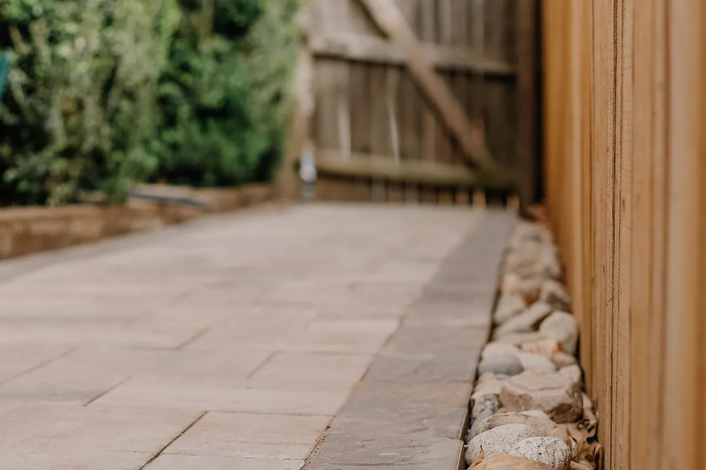

<strong>Direct answer:</strong> A typical 150 ft wood privacy fence in the USA costs about $5,250, with a sample range of $3,000 to $7,500. Use the <a href="{{ '/fence-cost-calculator/' | relative_url }}">Fence Cost Calculator</a> to price your fence.

All prices on this page are sample estimated USA ranges, not quotes. Your real price depends on your fence length, material, height, and the installer you hire.

Key Takeaways

<ul>
<li>A typical 150 ft wood privacy fence costs about $5,250, with a sample range of $3,000 to $7,500.</li>
<li>Installed cost per foot is $20 to $50 for wood, $30 to $60 for vinyl, and $9 to $30 for chain link.</li>
<li>A wood fence lasts about 15 to 20 years with regular care, while vinyl and chain link last about 20 to 30 years.</li>
<li>A 200 ft wood fence with two walk gates, old fence removal, and a permit totals $4,940 to $12,750 in the worked example.</li>
<li>Call 811 before digging, which is free, and check your HOA rules, city rules, and permit needs before anyone digs.</li>
</ul>

<figure></figure>

Price table

## Fence cost per foot installed

Swipe to see the High column &rarr;

  

<table class="cost-table">

<thead>
<tr><th>Material</th><th>Cost per foot</th><th>Typical cost per foot</th><th>Sample total for 150 ft</th></tr>
</thead>
<tbody>
<tr><td>Wood</td><td>$20 to $50</td><td>$35</td><td>$3,000 to $7,500</td></tr>
<tr><td>Vinyl</td><td>$30 to $60</td><td>$45</td><td>$4,500 to $9,000</td></tr>
<tr><td>Chain link</td><td>$9 to $30</td><td>$19.50</td><td>$1,350 to $4,500</td></tr>
</tbody>
</table>

Headline ranges are from HomeAdvisor and HomeGuide. Totals are the per foot price times 150 ft. For wood, $20 times 150 equals $3,000 and $50 times 150 equals $7,500. The typical 150 ft wood total of $5,250 uses the midpoint rate of $35 per foot, which matches the $5,250 average HomeAdvisor gives for a 150 ft wood fence.

A 6-foot privacy fence costs about $35 per foot typical for wood, in a sample range of $20 to $50 per foot installed, so a 150 ft wood privacy fence costs about $5,250 typical. Chain link costs $9 to $30 per foot installed, with $19.50 typical, so 200 ft of chain link fence costs $1,800 to $6,000, with $3,900 typical, from 200 times $19.50.

## What affects the price

### Fence length

Length is the biggest price driver, because every extra foot needs more posts, panels, and labor. Measure your fence line carefully, and add a little extra for corners and gates.

### Material choice

Chain link is the cheapest per foot, and wood privacy is the cheapest full privacy fence up front. Vinyl costs the most to install in these sample ranges. The right choice depends on privacy, looks, and how much care you want to do later.

### Height and style

A 6 ft privacy fence costs more than a 4 ft picket fence, because it uses taller posts and more material. Going from 4 ft to 6 ft adds about 30 to 50 percent per foot, per Quotsey, and an 8 ft fence adds about 25 to 35 percent over a 6 ft fence, per BuilderMuse. Decorative tops, lattice, and horizontal boards also add to the price.

### Ground and slope

Flat, clear ground is the cheapest to build on. Slopes, rocks, tree roots, and wet soil slow the crew down and add labor, and they can also need extra concrete and deeper posts.

### Gates and posts

Every gate adds material, hardware, and labor, at a sample price of $150 to $600 per walk gate, per RemodelCalculators. Wider posts, metal posts, and decorative post caps also add to the total.

## Worked example: a 200 ft wood fence

BuilderMuse works through a 200 ft wood fence with two walk gates, old fence removal, and a permit, and puts it at roughly $3,700 to $8,860. Here is the same job built up from the sourced ranges, so you can see where the money goes.

Swipe to see the High column &rarr;

  

<table class="cost-table">

<thead>
<tr><th>Item</th><th>Source range</th><th>Low</th><th>High</th></tr>
</thead>
<tbody>
<tr><td>200 ft wood fence, $20 to $50 per foot</td><td>HomeAdvisor and HomeGuide</td><td>$4,000</td><td>$10,000</td></tr>
<tr><td>Two walk gates, $150 to $600 each</td><td>RemodelCalculators</td><td>$300</td><td>$1,200</td></tr>
<tr><td>Old fence removal, $3 to $7 per foot</td><td>RemodelCalculators</td><td>$600</td><td>$1,400</td></tr>
<tr><td>Permit, $40 to $150</td><td>HomeAdvisor and HomeGuide</td><td>$40</td><td>$150</td></tr>
<tr class="total"><td>Totals</td><td></td><td>$4,940</td><td>$12,750</td></tr>
</tbody>
</table>

Arithmetic: low is $4,000 + $300 + $600 + $40 = $4,940. High is $10,000 + $1,200 + $1,400 + $150 = $12,750. BuilderMuse lands lower at both ends, at roughly $3,700 to $8,860, because it uses different per foot and permit assumptions for the same job. Post count for this job: 200 ft at 8 ft spacing is 200 / 8 + 2 = 27 posts, per the HomeAdvisor method quoted by BuilderMuse. A straight run alone needs 26 posts, and the extra post covers a corner or gate.

## Fence cost by material and height

Swipe to see the High column &rarr;

  

<table class="cost-table">

<thead>
<tr><th>Material</th><th>Height</th><th>Cost per foot</th><th>Sample total for 150 ft</th></tr>
</thead>
<tbody>
<tr><td>Chain link, galvanized</td><td>4 ft</td><td>$8 to $28</td><td>$1,200 to $4,200</td></tr>
<tr><td>Wood privacy, pressure treated pine</td><td>6 ft</td><td>$15 to $45</td><td>$2,250 to $6,750</td></tr>
<tr><td>Cedar privacy</td><td>6 ft</td><td>$22 to $60</td><td>$3,300 to $9,000</td></tr>
<tr><td>Vinyl privacy</td><td>6 ft</td><td>$25 to $60</td><td>$3,750 to $9,000</td></tr>
<tr><td>Aluminum, ornamental</td><td>6 ft</td><td>$25 to $75</td><td>$3,750 to $11,250</td></tr>
<tr><td>Composite privacy</td><td>6 ft</td><td>$20 to $85</td><td>$3,000 to $12,750</td></tr>
<tr><td>Wrought iron / steel</td><td>6 ft</td><td>$50 to $85</td><td>$7,500 to $12,750</td></tr>
</tbody>
</table>

Totals are the per foot price times 150 ft. Most rows use RemodelCalculators height and grade rows, so the 6 ft privacy rows differ from the headline ranges above: wood privacy 6 ft is $15 to $45 and vinyl privacy 6 ft is $25 to $60, which Angi also gives for vinyl privacy. Composite and wrought iron use the HomeAdvisor and HomeGuide ranges. For height changes, going from 4 ft to 6 ft adds about 30 to 50 percent per foot, per Quotsey, and 8 ft adds about 25 to 35 percent over 6 ft, per BuilderMuse.

## Whole fence cost by material and length

Swipe to see the High column &rarr;

  

<table class="cost-table">

<thead>
<tr><th>Material</th><th>100 ft</th><th>150 ft</th><th>200 ft</th><th>400 ft</th></tr>
</thead>
<tbody>
<tr><td>Chain link, $9 to $30 per foot</td><td>$900 to $3,000</td><td>$1,350 to $4,500</td><td>$1,800 to $6,000</td><td>$3,600 to $12,000</td></tr>
<tr><td>Pressure treated wood, $20 to $50 per foot</td><td>$2,000 to $5,000</td><td>$3,000 to $7,500</td><td>$4,000 to $10,000</td><td>$8,000 to $20,000</td></tr>
<tr><td>Vinyl, $30 to $60 per foot</td><td>$3,000 to $6,000</td><td>$4,500 to $9,000</td><td>$6,000 to $12,000</td><td>$12,000 to $24,000</td></tr>
</tbody>
</table>

Each total is the per foot range times the length. For a 400 ft vinyl fence, RemodelCalculators gives $10,000 to $24,000, close to the $12,000 to $24,000 above. A 400 ft composite fence runs $14,000 to $38,000, per RemodelCalculators.

## Fence cost by region

Prices move with local labor rates. Quotsey gives these ranges for a 150 ft pressure treated wood fence by region.

Swipe to see the High column &rarr;

  

<table class="cost-table">

<thead>
<tr><th>Region</th><th>Sample range</th></tr>
</thead>
<tbody>
<tr><td>Northeast</td><td>$3,200 to $6,500</td></tr>
<tr><td>Southeast</td><td>$2,400 to $4,800</td></tr>
<tr><td>Midwest</td><td>$2,600 to $5,000</td></tr>
<tr><td>West Coast</td><td>$3,000 to $6,000</td></tr>
</tbody>
</table>

Urban and coastal areas run about 40 to 60 percent higher than rural areas, per Quotsey, so a city quote can sit well above these ranges.

## Example fence budgets

Use these four budgets to place your own fence before you call an installer. Each total is the fence only, from the per foot ranges above, so gates, permits, and old fence removal sit on top.

Swipe to see the Sample cost column &rarr;

  

<table class="cost-table">

<thead>
<tr><th>Budget</th><th>Fence</th><th>Sample cost</th></tr>
</thead>
<tbody>
<tr><td>Small side yard</td><td>100 ft chain link</td><td>$900 to $3,000</td></tr>
<tr><td>Standard backyard</td><td>150 ft wood privacy</td><td>$3,000 to $7,500, about $5,250 typical</td></tr>
<tr><td>Privacy fence</td><td>150 ft vinyl</td><td>$4,500 to $9,000</td></tr>
<tr><td>Large yard</td><td>300 ft wood</td><td>$6,000 to $15,000</td></tr>
</tbody>
</table>

Each total is the per foot range times the length. For the standard backyard, 150 ft of wood at $20 to $50 per foot is $3,000 to $7,500, with about $5,250 typical.

## Where the money goes

At the $5,250 typical total for a 150 ft wood privacy fence, labor is about half the job, per HomeAdvisor, or about $2,625, and materials make up most of the rest. Shopping for cheaper panels can only ever move part of the bill. The labor half is set mostly by your ground and your local market, not by negotiation, which is why two honest quotes for the same fence can still differ by a lot.

## Sloped ground: stepped vs racked

A fence on a slope is built one of two ways, per RemodelCalculators. A racked fence tilts the panels to follow the ground, and it works on gentle slopes below about 15 degrees. A stepped fence keeps each panel level and steps down the slope, which works on steeper ground but leaves gaps under the panels and needs more posts. Grading to level the ground costs $500 to $3,000, per RemodelCalculators, so ask the installer which method they priced before you compare quotes.

## Replacement vs a new fence

Replacing an old fence costs more per foot than building on clear ground. HomeGuide puts replacement at $30 to $80 per linear foot, against $20 to $60 per linear foot for a new fence. Removal alone runs $3 to $7 per foot, per RemodelCalculators, corroborated by Angi at $3 to $7 for a wood fence. HomeAdvisor and HomeGuide put removal higher, at $10 to $20 per foot including disposal, so a quote that includes haul-away can run above $7 per foot. On a 150 ft fence, removal alone is $450 to $1,050 at $3 to $7 per foot. If the old posts are sound and the line is unchanged, ask whether the new fence can reuse the post holes, which can cut the labor.

## Lifetime cost per foot per year

The cheapest fence to install is not always the cheapest to own. RemodelCalculators gives these lifetime costs per foot per year, which spread the install price and the upkeep over the life of the fence.

Swipe to see the High column &rarr;

  

<table class="cost-table">

<thead>
<tr><th>Material</th><th>Cost per foot per year</th></tr>
</thead>
<tbody>
<tr><td>Chain link, galvanized</td><td>$0.75</td></tr>
<tr><td>Aluminum</td><td>$1.13</td></tr>
<tr><td>Vinyl privacy</td><td>$1.52</td></tr>
<tr><td>Cedar</td><td>$2.00</td></tr>
<tr><td>Composite</td><td>$2.18</td></tr>
<tr><td>Wood, pressure treated pine</td><td>$2.24</td></tr>
</tbody>
</table>

Wood lasts about 15 to 20 years, vinyl and chain link about 20 to 30 years, aluminum 30 years or more, and wrought iron 50 years or more, per Quotsey. A good fence can also add about 2 to 5 percent to home value, per Quotsey.

<aside class="pull-quote">

Money-saving tip

Where the fence sits on a shared line and your neighbor agrees, splitting the cost can cut your bill in half.

</aside>

## How much does it cost to install a fence?

Installation is the labor half of the bill: labor runs $10 to $30 per linear foot and is about half the job, per Quotsey. That is why the cheapest installed price is not always the cheapest fence, and why a quote that folds gates, removal, and permits into one per foot number is hard to compare. Ask each installer to list labor, gates, removal, and permit fees separately, and price your own fence first with the Fence Cost Calculator, so you know what the install should cost before the quotes arrive.

## DIY vs hiring a pro

Labor runs $10 to $30 per linear foot and is about half the job, per Quotsey, so doing it yourself can save real money on a long fence. BuilderMuse puts labor at about $1,600 on an average project, roughly half the total. The median wage for fence erectors is $23.07 per hour, or $47,980 per year, per the US Bureau of Labor Statistics, May 2025. A DIY build still needs post hole digging, concrete setting, level panels, and a call to 811 before digging, which is free. Hire a pro if the ground is sloped or rocky, the fence is over 6 ft, or the boundary is disputed, because fixing a crooked or misplaced fence costs more than building it right the first time.

## Before you build

Check these five things before anyone digs. A property survey costs $200 to $545, per BuilderMuse, and it settles where the fence can legally go. Call 811 before digging, which is free, per BuilderMuse, so buried lines get marked. Check your HOA rules, because many HOAs limit material, style, and height. Check your city setback rules, because a fence usually must sit inside your line, not on it. Check your city height cap, because front yard fences are often limited to a lower height than backyard fences. A permit costs $40 to $150, per HomeAdvisor and HomeGuide, depending on the city. Angi puts a typical fence permit lower, at $20 to $60.

## What is included and what is not included

<h3>What is included</h3>
<ul class="checklist">
<li>Posts, panels, or pickets</li>
<li>Concrete for the posts</li>
<li>Hardware, rails, and fasteners</li>
<li>Labor for install</li>
<li>Basic cleanup of the work area</li>
</ul>

<h3>What is not included</h3>
<ul class="checklist checklist-x">
<li>Old fence removal and disposal</li>
<li>Property survey</li>
<li>Permit fees</li>
<li>Gates, unless listed in the quote</li>
<li>Staining, sealing, or painting</li>
<li>Landscaping repair along the fence line</li>
</ul>

Staining is priced separately from the build: see <a href="{{ '/blog/how-much-does-it-cost-to-stain-a-fence/' | relative_url }}">how much it costs to stain a fence</a>.

## How to save money

<ul class="checklist">
<li><strong>Compare wood and vinyl over time.</strong> Wood costs less now, but vinyl needs less care, so vinyl can be cheaper across 20 years.</li>
<li><strong>Get 3 written quotes.</strong> Compare the same length, height, and material, and ask each installer to list gates, removal, and permit fees.</li>
<li><strong>Share a fence with a neighbor.</strong> Where the fence sits on a shared line and your neighbor agrees, splitting the cost can cut your bill in half.</li>
<li><strong>Choose a standard height.</strong> A standard 6 ft privacy fence is often cheaper than a taller custom fence, and it suits most yards.</li>
<li><strong>Clear the fence line yourself.</strong> Move plants, debris, and stored items before the crew arrives, so paid labor time goes to the fence itself.</li>
</ul>

## Common mistakes that raise the cost

<ul>
<li><strong>Building on the wrong line.</strong> A fence in the wrong place can mean moving it at your own expense, so confirm the boundary with a survey before anyone digs.</li>
<li><strong>Skipping the permit.</strong> A fence built without a permit can have to come down, and the fee is small next to the cost of moving a finished fence.</li>
<li><strong>Forgetting the gates.</strong> Gates are priced per unit, not per foot, at $150 to $600 per walk gate, so a quote without them is not the full price.</li>
<li><strong>Buying the cheapest wood and leaving it unstained.</strong> Wood needs staining or sealing every few years, so the lowest quote can become the highest cost over 20 years.</li>
<li><strong>Accepting shallow posts.</strong> Posts set shallow or spaced too wide lean within a few years, and the fix is digging them out and starting over.</li>
</ul>

## How to hire a fence installer

<ol class="steps">
<li><strong>Measure your fence line.</strong> Walk the line, measure the total length, and mark where each gate should go.</li>
<li><strong>Check your property lines and rules.</strong> Confirm the boundary, check your city height and permit rules, and check your HOA rules if you have one.</li>
<li><strong>Get 3 written quotes.</strong> Ask each installer for the same length, height, and material, with gates, removal, and permit fees listed.</li>
<li><strong>Ask for the post spec.</strong> Confirm wood or metal posts, post spacing, concrete depth, and how the posts are set.</li>
<li><strong>Check reviews and past work.</strong> Read recent reviews, look at photos of recent jobs, and ask for references you can call.</li>
<li><strong>Confirm the permit, warranty, and call to 811 in writing.</strong> The contract should list the material, the height, the price, the start date, and the warranty on labor and materials, and it should state who calls 811 before digging.</li>
</ol>

## How to measure your fence line

Measure before you ask for a quote, because length is the biggest price driver. Walk the line with a tape or a measuring wheel, and add a little extra for corners and gates. Count the posts too: at 8 ft spacing, a 200 ft fence needs 27 posts by the HomeAdvisor method, because 200 divided by 8 plus 2 equals 27. A straight run alone needs 26 posts, and the extra post covers a corner or gate. Mark where each gate should go, and note slopes, trees, and rocks along the line, because slopes, rocks, tree roots, and wet soil slow the crew down and add labor. A clear measurement means each installer prices the same fence, so the quotes are easy to compare.

## Fence care by material

Care needs differ by material, and they shape the lifetime cost. Wood needs the most care: seal or stain it every few years, keep the boards off the soil, and fix loose posts early, and it lasts about 15 to 20 years with regular care. Vinyl needs little care, and it lasts about 20 to 30 years. Chain link also lasts about 20 to 30 years, aluminum lasts 30 years or more, and wrought iron lasts 50 years or more. A fence that gets regular care lasts longer and costs less per year, so factor the upkeep into the choice, not just the install price.

## Fence cost over 20 years

The lifetime cost per foot per year turns into a yearly cost for a 150 ft fence. Chain link at $0.75 per foot per year costs about $113 a year for 150 ft. Aluminum at $1.13 costs about $170 a year. Vinyl at $1.52 costs about $228 a year. Cedar at $2.00 costs about $300 a year. Composite at $2.18 costs about $327 a year. Wood at $2.24 costs about $336 a year. Wood costs the most per year to own, even though it costs less than vinyl to install, because it needs staining and repairs. A good fence can also add about 2 to 5 percent to home value, so the lifetime cost is only one side of the value.

## Fence styles: which type fits your yard

Material is only half the choice. The style decides how much privacy you get, how the fence looks, and how much material it uses. A privacy fence uses solid boards with no gaps, so it blocks the view and the wind, and it uses the most material. A shadow box fence staggers boards on both sides of the rails, so it looks finished from both sides and lets some air through. A picket fence uses spaced vertical boards, so it marks the boundary and looks open, but it gives little privacy. A rail fence uses horizontal rails with wide gaps, so it suits a large yard or a rural boundary, but it will not keep small pets in. A split rail fence is a wood rail style that works well for property boundaries, but it is not the best for pets or privacy. An invisible or electric fence runs a wire underground and suits pet containment only, with no visible barrier at all. Match the style to the job first, then pick the material: a privacy style in wood or vinyl suits a backyard, while a picket or rail style suits a front yard where an open look matters more.

<figure></figure>

## Frequently asked questions

Wood or vinyl, which is cheaper?

Wood costs less up front, vinyl less over time. Wood needs staining and repairs, while vinyl needs little care, so vinyl can be cheaper across 20 years even though it costs more to install.

Do I need a permit?

Many US cities require a permit for a new fence, and some also limit the height and the style. Check your city rules and your HOA rules before you order materials.

How long does a wood fence last?

About 15 to 20 years with regular care. Sealing or staining every few years, keeping the boards off the soil, and fixing loose posts early all help a wood fence last longer.

How much is a gate?

A sample price is $150 to $600 per walk gate, per RemodelCalculators. Wide drive gates cost $600 to $1,500, and an automatic opener adds $500 to $2,000, per Quotsey.

What is not included?

Old fence removal and surveys are usually not included in a standard fence quote. Ask each installer to list removal, permit fees, and gates, so you know what the price does and does not cover.

How much does a 200 ft wood fence cost?

The fence alone costs $4,000 to $10,000 at $20 to $50 per foot, per HomeAdvisor and HomeGuide. With two walk gates, old fence removal, and a permit, the worked example in this guide totals $4,940 to $12,750.

How many posts does a 200 ft fence need?

At 8 ft spacing, a 200 ft fence needs 27 posts by the HomeAdvisor method, because 200 divided by 8 plus 2 equals 27. A straight run alone needs 26 posts, and the extra post covers a corner or gate.

Which fence is best for privacy?

A 6 ft wood or vinyl privacy fence gives the most privacy. A shadow box fence looks finished from both sides and lets some air through, while a picket or rail fence gives little privacy.

How much does it cost to build a fence?

To build a fence, multiply the length by the installed cost per foot, then add gates, permits, and removal. Installed cost per foot is $20 to $50 for wood, $30 to $60 for vinyl, and $9 to $30 for chain link, so a 150 ft wood privacy fence costs about $5,250 typical, with a sample range of $3,000 to $7,500. To put up a fence on the same 150 ft line in vinyl costs $4,500 to $9,000.

How much does a privacy fence cost?

A 6 ft wood privacy fence costs about $35 per foot typical, in a sample range of $20 to $50 per foot installed, so a 150 ft wood privacy fence costs about $5,250 typical. The same 150 ft line in vinyl costs $4,500 to $9,000 at $30 to $60 per foot.

How much does a chain link fence cost?

Chain link costs $9 to $30 per foot installed, with $19.50 typical, so a 150 ft chain link fence costs $1,350 to $4,500, with $2,925 typical.

How much does a wood fence cost?

Wood costs $20 to $50 per foot installed, with $35 typical, so a 150 ft wood privacy fence costs $3,000 to $7,500, with about $5,250 typical.

How much does it cost to replace a fence?

Replacement costs $30 to $80 per linear foot, per RemodelCalculators, against $20 to $60 per linear foot for a new fence, because replacement adds removal at $3 to $7 per foot. On a 150 ft fence, removal alone is $450 to $1,050.

## References

Headline price ranges in this guide come from HomeAdvisor and HomeGuide, with height and grade rows from RemodelCalculators and labor context from the US Bureau of Labor Statistics. All prices are sample estimated USA ranges, not quotes.

<a href="https://www.homeadvisor.pro/cost/fencing/install-a-fence/" target="_blank" rel="noopener">HomeAdvisor</a> fence installation cost by material

<a href="https://homeguide.com/costs/fence-installation-cost" target="_blank" rel="noopener">HomeGuide</a> fence installation cost by material

<a href="https://www.angi.com/articles/how-much-does-fence-installation-cost.htm?mf_ct_campaign=msn-feed" target="_blank" rel="noopener">Angi</a> fence installation cost, removal and permits

<a href="https://remodelcalculators.com/fence-cost" target="_blank" rel="noopener">RemodelCalculators</a> fence cost by material and height

<a href="https://www.bls.gov/" target="_blank" rel="noopener">US Bureau of Labor Statistics</a> fence erector wage data

## Compare with other home projects

If you are pricing a full exterior refresh, read <a href="{{ '/blog/how-much-does-it-cost-to-replace-a-roof/' | relative_url }}">how much it costs to replace a roof</a> and <a href="{{ '/blog/how-much-does-it-cost-to-paint-a-house/' | relative_url }}">how much it costs to paint a house</a>, and price the paintwork with the <a href="{{ '/house-painting-cost-calculator/' | relative_url }}">House Painting Cost Calculator</a>. If the fence is for a new home, see <a href="{{ '/blog/how-much-do-movers-cost/' | relative_url }}">how much movers cost</a>.

## Related links

<svg aria-hidden="true" width="30" height="30" viewBox="0 0 24 24" fill="none" stroke="currentColor" stroke-width="1.8" stroke-linecap="round" stroke-linejoin="round"><path d="M4 3v18M10 3v18M16 3v18M20 3v18"/><path d="M3 8h18M3 16h18"/></svg>

Home
<h3><a href="{{ '/fence-cost-calculator/' | relative_url }}">Fence Cost Calculator</a></h3>
$3,000 - $7,500
<a class="card-cta" href="{{ '/fence-cost-calculator/' | relative_url }}">Calculate your price &rarr;</a>

<svg aria-hidden="true" width="30" height="30" viewBox="0 0 24 24" fill="none" stroke="currentColor" stroke-width="1.8" stroke-linecap="round" stroke-linejoin="round"><path d="M2 12 12 3l10 9"/><path d="M6 10v10h12V10"/><path d="M9.5 14h2m2 0h2m-6 3h2m2 0h2"/></svg>

Home
<h3><a href="{{ '/roof-replacement-cost-calculator/' | relative_url }}">Roof Replacement Cost Calculator</a></h3>
$7,528 - $11,475
<a class="card-cta" href="{{ '/roof-replacement-cost-calculator/' | relative_url }}">Calculate your price &rarr;</a>

<svg aria-hidden="true" width="30" height="30" viewBox="0 0 24 24" fill="none" stroke="currentColor" stroke-width="1.8" stroke-linecap="round" stroke-linejoin="round"><path d="M3 4h13v6H3z"/><path d="M16 7h2a2 2 0 0 1 2 2v2"/><path d="M18 11v7a2 2 0 0 1-2 2h-1a2 2 0 0 1-2-2v-4"/></svg>

Home
<h3><a href="{{ '/house-painting-cost-calculator/' | relative_url }}">House Painting Cost Calculator</a></h3>
$2,800 - $6,800
<a class="card-cta" href="{{ '/house-painting-cost-calculator/' | relative_url }}">Calculate your price &rarr;</a>

<svg aria-hidden="true" width="30" height="30" viewBox="0 0 24 24" fill="none" stroke="currentColor" stroke-width="1.8" stroke-linecap="round" stroke-linejoin="round"><path d="M2 12 12 3l10 9"/><path d="M6 10v10h12V10"/><path d="M9.5 14h2m2 0h2m-6 3h2m2 0h2"/></svg>

Guide
<h3><a href="{{ '/blog/how-much-does-it-cost-to-replace-a-roof/' | relative_url }}">How Much Does It Cost to Replace a Roof?</a></h3>
$7,528 - $11,475
<a class="card-cta" href="{{ '/blog/how-much-does-it-cost-to-replace-a-roof/' | relative_url }}">Read the guide &rarr;</a>

<ul class="chip-list">
  <li><a href="{{ '/tools/' | relative_url }}">All Cost Calculators &rarr;</a></li>
</ul>
