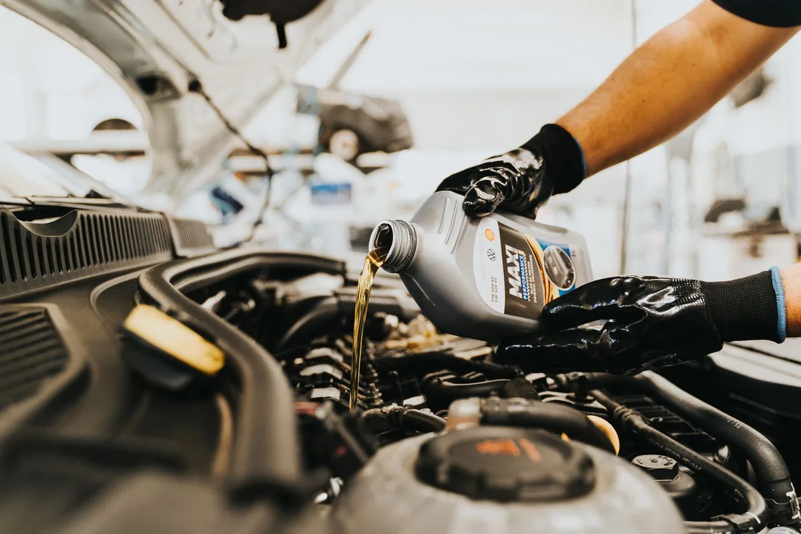

<strong>Direct answer:</strong> A typical full synthetic oil change in the USA costs about $75, with a sample range of $45 to $140. Use the <a href="{{ '/oil-change-cost-calculator/' | relative_url }}">Oil Change Cost Calculator</a> to price your car.

All prices on this page are sample estimated USA ranges, not quotes. Your real price depends on your oil type, your vehicle, and the shop you choose.

Key facts

<ul>
<li>A typical full synthetic oil change costs about $75, with a sample range of $45 to $140.</li>
<li>Conventional oil costs $35 to $75, synthetic blend $40 to $100, and full synthetic $65 to $125.</li>
<li>Change conventional oil every 3,000 to 5,000 miles, synthetic blend up to 7,500 miles, and full synthetic up to 10,000 miles.</li>
<li>At 12,000 miles a year, full synthetic costs about $90 a year, against about $135 a year for conventional oil.</li>
<li>A dealer oil change costs about $100, per SoFi, while a quick lube shop is often the cheapest and fastest.</li>
</ul>

<figure></figure>

## Oil change cost by oil type

Swipe to see the High column &rarr;

  

<table class="cost-table">

<thead>
<tr><th>Oil type</th><th>Sample range</th><th>Typical price</th></tr>
</thead>
<tbody>
<tr><td>Conventional</td><td>$35 to $75</td><td>$45</td></tr>
<tr><td>Synthetic blend</td><td>$40 to $100</td><td>$65</td></tr>
<tr><td>Full synthetic</td><td>$65 to $125</td><td>$75</td></tr>
<tr><td>High-mileage</td><td>$50 to $100</td><td>$75</td></tr>
<tr><td>Diesel</td><td>$80 to $200+</td><td>$140</td></tr>
<tr><td>European / specialty</td><td>$110 to $160+</td><td>$135</td></tr>
</tbody>
</table>

Conventional, blend, and full synthetic ranges are from SoFi, citing Kelley Blue Book. High-mileage, diesel, and European ranges are Firestone ranges published by MotorTriage. Typical prices are the calculator sample values, and each sits inside its range. SUVs and trucks cost about 25 percent more than a typical car, because they take more oil. A full synthetic change that costs $75 for a car costs about $94 for a larger vehicle.

## Conventional vs synthetic oil: what is the difference?

Conventional oil is crude oil that has been refined, and it is the cheapest option. It breaks down faster, so it needs changing every 3,000 to 5,000 miles, and it can struggle to flow at extreme temperatures. Synthetic blend is a mix of conventional and synthetic base oils, and it sits in the middle on price and on protection. Full synthetic oil is chemically engineered, with fewer impurities than conventional oil, and it protects the engine better in heat and cold while lasting up to 10,000 miles between changes. High-mileage oil is full synthetic with added seal conditioners, made for older engines that have started to burn or leak oil. Check your manual for the oil type and grade your engine needs: many modern cars require full synthetic, so the cheaper oil is not always an option.

## How much does an oil change cost at Jiffy Lube, Valvoline, Take 5, or Walmart?

Where you go matters as much as which oil you pick. Prices below are published ranges, checked September 7, 2026 by MotorTriage, except the dealer figure, which is from SoFi, dated March 6, 2026.

Swipe to see the High column &rarr;

  

<table class="cost-table">

<thead>
<tr><th>Provider</th><th>Conventional</th><th>Full synthetic</th></tr>
</thead>
<tbody>
<tr><td>Walmart</td><td>$28.88</td><td>$62.88</td></tr>
<tr><td>Firestone</td><td>$30 to $50</td><td>$70 to $130</td></tr>
<tr><td>Dealer</td><td colspan="2">About $100 for a standard oil change, per SoFi</td></tr>
</tbody>
</table>

Walmart and Firestone figures are from MotorTriage, with prices checked September 7, 2026. The dealer figure is from SoFi, citing Kelley Blue Book, which puts a dealer oil change at about $100. A dealer may include a full inspection, while a quick lube shop is faster and cheaper.

Quick lube chains such as Jiffy Lube, Valvoline, and Take 5 generally fall within the $45 to $140 range on this page, with $75 typical for a full synthetic change. This guide does not publish a price for any one chain, because prices vary by location and oil type, so ask the shop to confirm the oil type, grade, and filter in the quote.

<strong>Best value:</strong> if price matters most, Walmart is the cheapest in the table above, at $28.88 for conventional and $62.88 for full synthetic. If speed matters most, a quick lube shop is usually the fastest, and it suits a standard oil change on a common car. If the car is under warranty, the dealer is the safest choice even though it costs about $100, because the service is logged against the car. An independent shop sits between the two on price, and it suits a car that needs other work at the same visit.

## Why your bill was higher than the advertised price

An advertised oil change price usually covers the base oil, a standard filter, and basic labor for a small car. Your bill grows when your car needs more than the base job, per MotorTriage. Each extra quart over 5 costs $7 to $12. An OEM or cartridge filter adds $5 to $25 over a standard filter. Access labor, for cars where the filter or drain is hard to reach, adds $10 to $30. Shop supplies and disposal add $5 to $15. Ask for the full price, including the filter type, the quart count, and the shop fees, before the work starts, so the advertised price and your bill match.

## How much does an oil change cost per year

Full synthetic costs more per visit but lasts longer, so it can cost less per year. At 12,000 miles a year, the math runs like this. Conventional oil at $45 a change every 4,000 miles, the middle of the 3,000 to 5,000 mile interval, is 3 changes a year, or $135 a year. Synthetic blend at $65 a change every 7,500 miles is 1.6 changes a year, or about $104 a year. Full synthetic at $75 a change every 10,000 miles is 1.2 changes a year, or $90 a year. The 12,000 miles a year figure is an assumption for this comparison, so redo it with your own yearly miles. A dealer visit can also cost more per change, at about $100, per SoFi, which moves the yearly total up the same way.

<aside class="pull-quote">

Money-saving tip

Follow your manual interval. Changing oil more often than your manual says wastes money, and changing it late can damage the engine.

</aside>

## DIY vs hiring a pro

Doing it yourself costs $25 to $50 in parts, per HowMuchDoesThatCost, and SoFi puts the saving at $25 to $75 per change against paying a shop. A shop charges for labor, the filter, and disposal, and it also takes the old oil away. If you change your own oil, collect the used oil in a sealed container and take it to an auto parts store or a recycling center. The US Environmental Protection Agency guidance for used oil is to recycle it, never to pour it down a drain or on the ground. Hire a pro if your car needs a special oil grade, the filter is hard to reach, or you have nowhere safe to work under the car.

<figure></figure>

## What affects the price

### Oil type

Oil type is the biggest price driver. Conventional oil is the cheapest, synthetic blend sits in the middle, and full synthetic costs the most per change but lasts longer between changes.

### Vehicle size and engine

Larger engines take more quarts of oil, so SUVs and trucks cost about 25 percent more than a typical sedan. Some luxury and performance cars also need a special oil grade that costs more.

### Where you go

A dealer usually charges the most, an independent shop is often cheaper, and a quick lube shop is often the cheapest and fastest. The price difference is mostly labor rates and overhead, not the oil itself.

### Your location

Labor rates vary across the USA. Big cities usually cost more than small towns for the same oil change, and prices can also vary between shops in the same town.

### Extra services

A shop may add a new air filter, a cabin filter, a tire rotation, or a fluid top up to the bill. Ask what is included in the quoted price, and say no to add-ons you do not need.

## What is included and what is not included

<h3>What is included</h3>
<ul class="checklist">
<li>Engine oil in the grade your car needs</li>
<li>New oil filter</li>
<li>Drain plug check and new washer where needed</li>
<li>Fluid top up and basic multi point check</li>
<li>Tire pressure check</li>
<li>Old oil disposal</li>
</ul>

<h3>What is not included</h3>
<ul class="checklist checklist-x">
<li>Engine air filter</li>
<li>Cabin air filter</li>
<li>Other fluid changes, such as coolant or transmission fluid</li>
<li>Repairs found during the check</li>
<li>Premium filter upgrades</li>
<li>Tire rotation, unless listed in the quote</li>
</ul>

## How to save money

<ul class="checklist">
<li><strong>Follow your manual interval.</strong> Changing oil more often than your manual says wastes money, and changing it late can damage the engine.</li>
<li><strong>Compare 3 local prices.</strong> Call a dealer, an independent shop, and a quick lube shop, and compare the full price for the same oil type.</li>
<li><strong>Skip unneeded add-ons.</strong> Say no to filters and flushes you do not need, and check your manual before you agree to extra work.</li>
<li><strong>Use coupons and bundle deals.</strong> Shops often offer coupons, and bundling an oil change with a tire rotation can cost less than booking them apart.</li>
<li><strong>Use the right oil, not the priciest oil.</strong> If your manual allows a blend, you do not need to pay for full synthetic on every change.</li>
</ul>

## How to hire a pro

<ol class="steps">
<li><strong>Check your manual for the oil type.</strong> Note the oil grade, the oil type, and the change interval before you call any shop.</li>
<li><strong>Get 3 prices for the same oil.</strong> Ask each shop for the full price, including the filter, disposal, and any shop fees.</li>
<li><strong>Ask what is included.</strong> Confirm the oil brand and grade, the filter type, and the basic check, so you know what you are paying for.</li>
<li><strong>Ask about the filter type and the disposal fee.</strong> An OEM or cartridge filter costs more than a standard filter, and the disposal fee may sit outside the quoted price.</li>
<li><strong>Look for a coupon before you book.</strong> Shops often offer coupons, and bundling an oil change with a tire rotation can cost less than booking them apart.</li>
<li><strong>Check reviews and the shop.</strong> Read recent reviews, and pick a shop that is clean, busy, and clear about its prices.</li>
<li><strong>Keep your receipt and mileage.</strong> Save the receipt, note the mileage, and set a reminder for the next change at the interval in your manual.</li>
</ol>

## Oil change cost by vehicle size

SUVs and trucks cost about 25 percent more than a typical car, because they take more oil. The table below applies that 25 percent to the typical prices on this page.

Swipe to see the SUV and truck price &rarr;

  

<table class="cost-table">

<thead>
<tr><th>Oil type</th><th>Typical car price</th><th>About 25 percent more for SUV and truck</th></tr>
</thead>
<tbody>
<tr><td>Conventional</td><td>$45</td><td>About $56</td></tr>
<tr><td>Synthetic blend</td><td>$65</td><td>About $81</td></tr>
<tr><td>Full synthetic</td><td>$75</td><td>About $94</td></tr>
</tbody>
</table>

Math: $45 times 1.25 is $56.25, $65 times 1.25 is $81.25, and $75 times 1.25 is $93.75, rounded to about $94. Diesel and European cars cost more again, at $80 to $200 plus for diesel and $110 to $160 plus for European and specialty cars.

## Signs your oil needs changing

Your manual interval is the main guide, but a few signs mean you should check the oil now. Dark, gritty oil on the dipstick, a low oil level, an oil warning light, a loud engine, or an exhaust smell are all worth a check. Hard driving shortens the interval, so a car that does short trips, towing, or dusty roads may need oil sooner than the manual interval. Do not wait for the engine to sound rough: changing oil late can damage the engine, and an engine repair costs far more than an oil change.

## What to check after an oil change

<ul class="checklist">
<li><strong>Check the oil level on the dipstick.</strong> It should sit between the marks, not above or below them.</li>
<li><strong>Check for leaks under the car.</strong> Look under the car after the first short drive, and check the drain plug area.</li>
<li><strong>Check the receipt.</strong> Confirm the oil grade, the oil type, and the filter listed on the receipt match what you agreed.</li>
<li><strong>Note the mileage and the date.</strong> Write down the mileage at the change, and set a reminder for the next change at the interval in your manual.</li>
<li><strong>Check the oil light and the sticker.</strong> The shop should reset the oil light and put a reminder sticker on the windshield.</li>
</ul>

## What happens if you skip an oil change

Skipping an oil change saves $45 to $75 now and risks a far bigger bill later. Old oil loses its ability to lubricate, so the engine wears faster, runs hotter, and collects more buildup. A low oil level, a warning light, or a loud engine are signs to check the oil at once, not at the next service. Hard driving shortens the interval, so a car that does short trips, towing, or dusty roads may need oil sooner than the manual interval. Time matters too, even if you barely drive: oil still needs changing about twice a year to stop gunk from building up, because short trips never warm the engine enough to burn off moisture. Follow your manual interval for mileage and for time, whichever comes first, and change oil late only if you accept the engine risk that comes with it.

## Benefits of regular oil changes

Regular oil changes do more than keep the engine running: they keep it clean, efficient, and cool.

<ul class="checklist">
<li><strong>Cleaner engine.</strong> Fresh oil carries dirt, debris, and contaminants out of the engine with the old oil.</li>
<li><strong>Better gas mileage.</strong> A clean engine with fresh oil works more efficiently, which helps fuel economy.</li>
<li><strong>Longer engine life.</strong> Fresh oil lubricates properly, so moving parts wear more slowly.</li>
<li><strong>Less overheating.</strong> Oil also cools the engine, and old oil cannot do that job as well.</li>
<li><strong>Fewer costly repairs.</strong> A $75 oil change on schedule is far cheaper than the engine damage that skipped changes can cause.</li>
</ul>

## DIY vs a professional shop, side by side

Doing it yourself costs $25 to $50 in parts, and the saving against paying a shop is $25 to $75 per change. A shop charges for labor, the filter, and disposal, and it also takes the old oil away and checks the car while it is there. A quick lube shop is often the cheapest and fastest professional option, an independent shop costs a little more but gives personal service, and a dealer costs the most at about $100, but knows your make and model best, which matters most while the car is under warranty. A cheap oil change can carry hidden risks, such as low grade oil, off brand filters, poorly trained technicians, and skipped checks, so a low price is not always a good deal. Pick the option that fits your tools, your time, and your warranty, not just the price on the sign.

## Frequently asked questions

How often should I change my oil?

Conventional oil every 3,000 to 5,000 miles, synthetic blend up to 7,500 miles, and full synthetic up to 10,000 miles, per SoFi citing Kelley Blue Book. Check your owner manual, because hard driving shortens the interval.

Is full synthetic worth it?

Yes for most modern cars. Full synthetic oil protects the engine better in heat and cold, and it lasts longer between changes, so it can be cheaper over time even though one change costs more.

How long does it take?

About 30 to 45 minutes at most shops. Quick lube shops are often faster, while a dealer visit can take longer if the car waits in line for a service bay.

What is included?

A standard oil change includes the engine oil, a new oil filter, and a basic check of fluids and tire pressure. Ask the shop to list exactly what is included before you agree to the price.

Can I change my own oil?

Yes, if you have the tools and a safe place to work. Recycle the old oil properly at an auto parts store or a recycling center, and never pour it down a drain or on the ground.

Why was my oil change bill higher than the advertised price?

Extra quarts cost $7 to $12 each over 5 quarts, an OEM or cartridge filter adds $5 to $25, access labor adds $10 to $30, and shop supplies and disposal add $5 to $15, per MotorTriage.

How much does an oil change cost per year?

At 12,000 miles a year, conventional oil costs about $135 a year, synthetic blend about $104 a year, and full synthetic about $90 a year, because full synthetic lasts up to 10,000 miles between changes.

How much does an oil change cost for an SUV?

About $94 for a full synthetic change, because SUVs and trucks cost about 25 percent more than a typical car. A full synthetic change that costs $75 for a car costs about $94 for a larger vehicle.

Does a dealer oil change cost more?

Yes, usually. A dealer oil change costs about $100, while a quick lube shop is often the cheapest and fastest. A dealer may include a full inspection, while a quick lube shop is faster and cheaper.

How often should I change oil if I barely drive?

About twice a year, even if the miles are low. Oil still needs changing on time to stop gunk from building up, so follow your manual interval for mileage and for time, whichever comes first.

How much does an oil change cost?

About $75 typical for a full synthetic oil change, in a sample range of $45 to $140. Conventional oil costs $35 to $75, synthetic blend $40 to $100, and full synthetic $65 to $125. Use the Oil Change Cost Calculator to price your own car.

Is $100 a lot for an oil change?

It depends on the oil and the shop. $100 is above the $75 typical price for a full synthetic change, but it sits inside the $45 to $140 sample range, and a dealer oil change costs about $100. Ask the shop for a breakdown of the $100 before you agree to it.

How much does an oil change cost at Jiffy Lube, Valvoline, or Take 5?

This guide does not publish a price for Jiffy Lube, Valvoline, or Take 5, because prices vary by location and oil type. Quick lube shops generally fall within the $45 to $140 range on this page, with $75 typical for a full synthetic change. Ask the shop to confirm the oil type, grade, and filter in the quote.

How much does an oil change cost at Walmart?

Walmart prices are listed in the provider table above: $28.88 for conventional and $62.88 for full synthetic, checked September 7, 2026 by MotorTriage. Prices vary by location and oil type, so ask the shop to confirm the oil type, grade, and filter in the quote.

## References

Price ranges in this guide come from SoFi, citing Kelley Blue Book, and from MotorTriage, with typical prices from HowMuchDoesThatCost and ARI invoice data. All prices are sample estimated USA ranges, not quotes.

<a href="https://www.sofi.com/learn/content/average-cost-oil-change/" target="_blank" rel="noopener">SoFi</a> oil change cost by oil type, citing Kelley Blue Book

## Compare with other car costs

An oil change is the cheapest regular car job. For bigger car spending, price a wrap with the <a href="{{ '/car-wrap-cost-calculator/' | relative_url }}">Car Wrap Cost Calculator</a> and read <a href="{{ '/blog/how-much-does-it-cost-to-paint-a-car/' | relative_url }}">how much it costs to paint a car</a>. If the car is part of a move, see <a href="{{ '/blog/how-much-do-movers-cost/' | relative_url }}">how much movers cost</a>.

## Related links

<svg aria-hidden="true" width="30" height="30" viewBox="0 0 24 24" fill="none" stroke="currentColor" stroke-width="1.8" stroke-linecap="round" stroke-linejoin="round"><path d="M12 3s6 6.5 6 11a6 6 0 0 1-12 0c0-4.5 6-11 6-11z"/><path d="M9.5 14a2.5 2.5 0 0 0 2.5 2.5"/></svg>

Car
<h3><a href="{{ '/oil-change-cost-calculator/' | relative_url }}">Oil Change Cost Calculator</a></h3>
$45 - $140
<a class="card-cta" href="{{ '/oil-change-cost-calculator/' | relative_url }}">Calculate your price &rarr;</a>

<svg aria-hidden="true" width="30" height="30" viewBox="0 0 24 24" fill="none" stroke="currentColor" stroke-width="1.8" stroke-linecap="round" stroke-linejoin="round"><path d="M4.5 11 6 7.2A2 2 0 0 1 7.9 6h8.2a2 2 0 0 1 1.9 1.2L19.5 11"/><rect x="3" y="11" width="18" height="5.5" rx="1.5"/><circle cx="7.5" cy="18" r="1.8"/><circle cx="16.5" cy="18" r="1.8"/></svg>

Car
<h3><a href="{{ '/car-wrap-cost-calculator/' | relative_url }}">Car Wrap Cost Calculator</a></h3>
$2,500 - $5,500
<a class="card-cta" href="{{ '/car-wrap-cost-calculator/' | relative_url }}">Calculate your price &rarr;</a>

<svg aria-hidden="true" width="30" height="30" viewBox="0 0 24 24" fill="none" stroke="currentColor" stroke-width="1.8" stroke-linecap="round" stroke-linejoin="round"><rect x="9" y="9" width="6" height="12" rx="1"/><path d="M11 9V5h2v4"/><path d="M12 2v1.5"/><path d="M9 5.5 7 3.5M15 5.5 17 3.5"/></svg>

Guide
<h3><a href="{{ '/blog/how-much-does-it-cost-to-paint-a-car/' | relative_url }}">How Much Does It Cost to Paint a Car?</a></h3><a class="card-cta" href="{{ '/blog/how-much-does-it-cost-to-paint-a-car/' | relative_url }}">Read the guide &rarr;</a>

<ul class="chip-list">
  <li><a href="{{ '/blog/how-much-do-movers-cost/' | relative_url }}">How Much Do Movers Cost in the USA? &rarr;</a></li>
  <li><a href="{{ '/tools/' | relative_url }}">All Cost Calculators &rarr;</a></li>
</ul>
