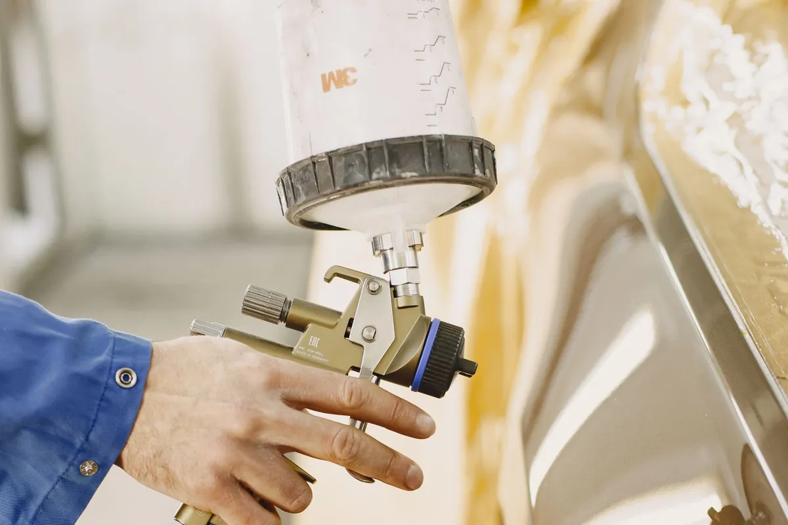
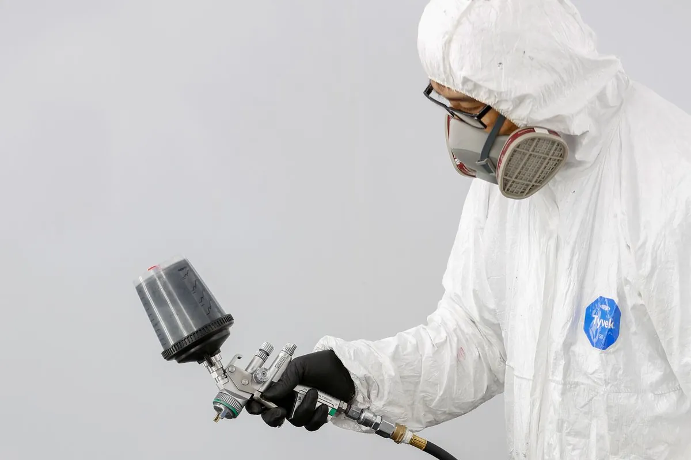

<strong>Direct answer:</strong> A typical quality repaint for a sedan in the USA costs about $3,500, with a sample range of $1,500 to $10,000 by quality. Price your own job with the <a href="{{ '/paint-a-car-cost-calculator/' | relative_url }}">Paint a Car Cost Calculator</a>. For a vinyl wrap instead, use the <a href="{{ '/car-wrap-cost-calculator/' | relative_url }}">Car Wrap Cost Calculator</a> to price the wrap.

All prices on this page are sample estimated USA ranges, not quotes. Your real price depends on your car size, the paint quality, the prep work, and the shop you choose.

Key Takeaways

<ul>
<li>A typical quality repaint for a sedan costs about $3,500, with a sample range of $1,500 to $10,000 by quality.</li>
<li>Basic single coat costs $1,500 to $2,499, standard quality $2,500 to $4,999, and show quality $5,000 to $10,000.</li>
<li>Prep can exceed half the bill, so on a $3,500 repaint that is more than $1,750 of prep.</li>
<li>A color change adds 15 to 25 percent, and 20 to 40 percent for a full color change, so up to $4,900 on a $3,500 repaint at 40 percent.</li>
<li>Base and clear coat paint lasts 10 to 15 plus years, while single-stage paint fades in 5 to 8 years.</li>
</ul>

Price table

## Car paint cost by paint job quality

How much does it cost to paint a whole car? A full repaint costs $1,500 to $10,000 by quality, with a standard quality sedan repaint about $3,500. How much does it typically cost to paint a car? About $3,500 for a standard sedan repaint, because that is the tier most daily drivers fall into.

Swipe to see the High column &rarr;

  

<table class="cost-table prose-4">

<thead>
<tr><th>Paint job quality</th><th>Sample range</th><th>Typical price</th><th>Warranty</th><th>Turnaround</th><th>Finish life</th><th>Best for</th></tr>
</thead>
<tbody>
<tr><td>Basic single coat</td><td>$1,500 to $2,499</td><td>$2,000</td><td>6 months to 1 year</td><td>About 3 to 7 days for most repaints</td><td>Single-stage paint fades in 5 to 8 years</td><td class="best-for">A budget repaint</td></tr>
<tr><td>Standard quality</td><td>$2,500 to $4,999</td><td>$3,500</td><td>3 to 5 years</td><td>About 3 to 7 days for most repaints</td><td>Base and clear coat lasts 10 to 15 plus years</td><td class="best-for">Most daily drivers</td></tr>
<tr><td>Show quality</td><td>$5,000 to $10,000</td><td>$7,500</td><td>Lifetime</td><td>Longer than a standard job, more coats and more sanding between coats</td><td>Base and clear coat lasts 10 to 15 plus years</td><td class="best-for">Show cars, and cars kept for many years</td></tr>
</tbody>
</table>

AAA prices a small car repaint at $2,000 to $3,500 and an SUV or truck repaint at $3,500 to $7,000. CARFAX prices a low-end professional job at $1,200 to $2,200, a midlevel job at $3,500 to $5,000, and a high-end job at $7,000 to $15,000. The ranges differ because each source draws the tier lines in a different place, so compare the prep and paint listed in a quote, not the tier name alone.

## Why the sources disagree: KBB vs CARFAX

Kelley Blue Book and CARFAX do not agree on the tier prices, and neither is wrong, they split the market differently. Kelley Blue Book prices basic at $1,000 to $1,500, mid at $2,000 to $5,000, and high at $5,000 to $10,000 plus, with a mid-tier sedan benchmark of about $4,000. CARFAX prices a low-end professional job at $1,200 to $2,200, a midlevel job at $3,500 to $5,000, and a high-end job at $7,000 to $15,000.

## What you are buying: prep stages and paint systems

Most of the price is prep, not paint. Prep can exceed half the bill, per CARFAX, so on a $3,500 repaint that is more than $1,750 of prep. The prep stages are wash and strip, sanding, dent and rust repair, masking, primer, and sanding the primer smooth before any color goes on. A quote that skips a stage is not the same job at a lower price, it is a smaller job.

Paint systems differ too. Single-stage paint mixes color and gloss in one coat and fades in 5 to 8 years. Base and clear coat paint lays color first and clear coat second and lasts 10 to 15 plus years. Tri-coat or pearl paint adds 15 to 25 percent to the price, and matte paint adds $2,000 to $6,000 more than glossy, per AAA. About 1 gallon of paint covers a midsize sedan and 1.5 gallons covers an SUV, per CARFAX.

<figure></figure>

## Paint systems side by side

The paint system decides how long the finish lasts and how much of the price is paint against prep. Compare the system in the quote, not just the total.

Swipe to see the Price note column &rarr;

  

<table class="cost-table">

<thead>
<tr><th>Paint system</th><th>How it works</th><th>Finish life</th><th>Price note</th></tr>
</thead>
<tbody>
<tr><td>Single-stage</td><td>Color and gloss in one coat</td><td>Fades in 5 to 8 years</td><td>Lowest cost tier, basic jobs</td></tr>
<tr><td>Base and clear coat</td><td>Color first, clear coat second</td><td>Lasts 10 to 15 plus years</td><td>Standard and show quality jobs</td></tr>
<tr><td>Tri-coat, also called pearl</td><td>Base coat, pearl coat, clear coat</td><td>Not stated separately in the sources used</td><td>Adds 15 to 25 percent to the price</td></tr>
</tbody>
</table>

A base and clear coat job costs more up front than a single-stage job, but it lasts about twice as long, so compare the finish life, not just the quote. The per year math in this guide shows the same point: a standard $3,500 repaint is $350 a year over 10 years, while a basic $2,000 repaint is $400 a year over 5 years.

<aside class="pull-quote">

Money-saving tip

A quote that skips a stage is not the same job at a lower price, it is a smaller job.

</aside>

## Cost by vehicle size and labor hours

Labor hours drive the vehicle size gap. A sedan takes 30 to 40 labor hours and an SUV or truck takes 55 to 75 labor hours, at $40 to $120 per hour. That gives sedan labor of 30 x $40 = $1,200 at the low end to 40 x $120 = $4,800 at the high end, and SUV or truck labor of 55 x $40 = $2,200 to 75 x $120 = $9,000. Worked examples: a 2010 Camry budget repaint at $750 to $1,400, a 2018 F-150 premium repaint at $8,500 to $14,500, and a 1969 Mustang show repaint at $22,000 to $45,000.

## Color change: the hidden price

A color change costs more than the same color again because the shop must paint the parts you see when a door, hood, or trunk is open: door jambs, the engine bay, and the trunk channels. A color change adds 15 to 25 percent, and 20 to 40 percent for a full color change, plus 1 to 2 extra days. On a $3,500 repaint, plus 15 percent is $3,500 x 0.15 = $525, for $4,025, plus 25 percent is $3,500 x 0.25 = $875, for $4,375, and plus 40 percent is $3,500 x 0.40 = $1,400, for $4,900. Ask whether jambs, engine bay, and trunk channels are in the quote before you agree to a price.

## Bodywork: the other hidden cost

Rust repair, dent repair, and trim and glass removal are usually priced apart from the paint, and they are the reason a cheap quote can end up costing more than a dearer one. Prep can exceed half the bill, per CARFAX, so on a $3,500 repaint expect more than $1,750 of prep if the car needs sanding, rust work, and dent work. Decide before you get quotes whether small dents stay or go, so each shop prices the same job.

## Cheap vs expensive: compare the prep, not the price

A $1,500 repaint and a $10,000 repaint are rarely the same service at different markups. A low quote usually masks the trim and sands the existing finish, while a mid level job removes some trim and bumpers and does more surface preparation, and a high end job removes the exterior trim and adds extensive body preparation. That is why the tier name alone tells you little: two shops can both call a job standard and still do different amounts of prep. Before you compare prices, check these 5 lines in every quote: the prep stages listed, whether trim is removed or masked, the paint system, the number of coats of base and clear coat, and the warranty. A quote that skips a stage is not the same job at a lower price, it is a smaller job.

## Repaint vs car value: the percent test

Judge a repaint by its share of the car value. A $4,000 repaint, about the mid-tier sedan benchmark per Kelley Blue Book, is 50 percent of an $8,000 car ($4,000 / $8,000 = 50 percent), 20 percent of a $20,000 car ($4,000 / $20,000 = 20 percent), and 10 percent of a $40,000 car ($4,000 / $40,000 = 10 percent). A repaint that costs half the car is hard to justify on a daily driver unless you plan to keep the car for years, while the same repaint at 10 percent of the car value is a normal upkeep cost.

## Three budgets: which one fits your car

Pick the budget by the car and by how long you plan to keep it, not by the lowest quote. An older daily driver with sound paint and limited body damage fits a basic job at $1,500 to $2,499, with the tradeoff of less disassembly, less correction work, and a simpler coating package. A mid level sedan that needs more preparation, some trim removal, good color matching, and a multi-year warranty fits a standard job at $2,500 to $4,999, about $3,500 typical. A keeper or show car with extensive disassembly, body correction, premium materials, jamb work, and color sanding and polishing fits a show quality job at $5,000 to $10,000. The same car can fit any of the three budgets, so the deciding question is what the car is worth to you over the years you will keep it.

## When a repaint does not make sense

A repaint does not make sense when the math or the metal argues against it. It does not make sense when you are spending a large share of the car value only in the hope of recovering every dollar at resale, because a $5,000 paint job does not automatically add $5,000 to the car value. It does not make sense when rust or failing bodywork is being hidden rather than repaired, because paint does not repair bad metal. It does not make sense when you only want a reversible color change and the existing paint is healthy enough for a wrap, because a wrap is cheaper and reversible. And it rarely makes sense when the car is only a few years old and the paint is sound. In each of those cases, fix the bodywork first, or choose the wrap, and revisit paint when the car and the goal fit the job.

## Paint vs wrap: how to decide

Paint lasts longer and a wrap is cheaper and reversible. Choose paint if you plan to keep the car for many years and want the finish to last 10 to 15 plus years with a base and clear coat system. Choose a wrap if you want a color change for a short time, or you want to protect the paint underneath and undo the change later. Price the wrap with the Car Wrap Cost Calculator, a sedan full wrap costs about $3,500 there.

## DIY vs a professional shop

A DIY paint job costs far less in labor but it needs a spray booth, a respirator, and safe handling of paint fumes, and the finish rarely matches a shop job. NIOSH gives safety guidance for DIY paint work, so follow it if you spray paint yourself: use the respirator and ventilation NIOSH calls for, and do not spray in a closed garage. How much does it cost to spray paint a car is not priced in this guide, because a spray can job and a shop repaint are different jobs with different prep, paint, and finish. A professional shop gives a booth, proper ventilation, and a warranty you can claim on, which is what you are paying for as well as the paint.

## Protecting new paint

New paint needs protection in its first months. Ceramic coating costs $500 to $2,000 and paint protection film costs $1,000 to $8,000. Paint materials rose 7.4 percent in 2025, per Kelley Blue Book, so a quote from last year is not a reliable guide to this year price.

The direct answer range of $1,500 to $10,000 runs from the low end of a basic job to the high end of a show quality job, as the table shows.

## What affects the price

### Car size

Bigger cars need more paint and more labor. A sedan costs less to paint than an SUV or a truck, because there is less surface to prep, prime, and paint.

### Paint quality and color

Better paint costs more, and some colors cost more than others. Metallic and pearl colors need extra coats, and a color change costs more than painting the same color again. How much does it cost to paint a car black? Black has no separate price in this guide: it is a common color, and the price still depends on the paint quality, the number of coats, and the prep, not on the color name alone. Black shows dust, swirls, and thin spots more clearly than a light color, so the finish work matters more.

### Prep work needed

Prep is where most of the labor goes. Sanding, rust repair, and dent repair all add hours, and a car with faded paint, chips, and dents costs more to prep than a car in good shape.

### Shop location and reputation

Labor rates vary across the USA, and big cities usually cost more than small towns for the same job. A shop with a strong reputation and a paint booth also charges more than a low cost shop.

### Extras such as door jambs and engine bay

Painting the door jambs, the engine bay, and the trunk costs extra, because the shop must remove trim and parts to reach those areas. Ask if these are included before you agree to a price.

## What is included and what is not included

<h3>What is included</h3>
<ul class="checklist">
<li>Prep and sanding</li>
<li>Primer</li>
<li>Base paint in your chosen color</li>
<li>Clear coat</li>
<li>Masking of glass, trim, and tires</li>
<li>Basic polish after the paint cures</li>
</ul>

<h3>What is not included</h3>
<ul class="checklist checklist-x">
<li>Rust repair</li>
<li>Dent and body repair</li>
<li>Door jambs and engine bay, often extra</li>
<li>Trim and glass removal, unless listed</li>
<li>Custom graphics or two tone paint</li>
<li>Rental car while your car is in the shop</li>
</ul>

## How to save money

<ul class="checklist">
<li><strong>Get 3 written quotes.</strong> Compare the same quality level, the same prep, and the same paint brand, not just the bottom line price.</li>
<li><strong>Pick standard quality unless you need show quality.</strong> Standard quality suits most daily drivers, and it costs about 47 percent of a show quality job.</li>
<li><strong>Ask what prep is included.</strong> A cheap quote can leave out sanding and rust repair, and those extras can cost more than the saving.</li>
<li><strong>Fix small dents first, or leave them.</strong> Decide before you get quotes, so each shop prices the same job and you can compare them fairly.</li>
<li><strong>Consider a wrap for a color change.</strong> A vinyl wrap is cheaper than a full color change paint job, and it is reversible if you change your mind.</li>
</ul>

## How to hire a paint shop

How much does it cost to have a car painted depends on the quality level, the prep, and the paint system, so the steps below keep every shop on the same job. Ask each shop for the same quality level and the same prep, with the paint brand, the number of coats, and the clear coat listed.

<ol class="steps">
<li><strong>Inspect past work in person.</strong> Visit the shop, look at cars it has painted, and check for runs, orange peel, and poor color match.</li>
<li><strong>Get 3 written quotes.</strong> Ask each shop for the same quality level and the same prep, with the paint brand, the number of coats, and the clear coat listed.</li>
<li><strong>Ask about the paint and the coats.</strong> Confirm the paint brand, how many coats of base and clear coat are included, and whether door jambs are included.</li>
<li><strong>Check reviews and the warranty.</strong> Read recent reviews, and ask how long the warranty lasts and what it covers, such as peeling and fading.</li>
<li><strong>Confirm the timeline in writing.</strong> The contract should list the price, the start date, the finish date, and the warranty terms before you leave the car.</li>
</ol>

## Paint cost per year of ownership

A dearer paint job can cost less per year if it lasts longer. Base and clear coat paint lasts 10 to 15 plus years, while single-stage paint fades in 5 to 8 years. On a standard $3,500 repaint with base and clear coat, the cost is $350 a year over 10 years and about $233 a year over 15 years. On a basic $2,000 repaint with single-stage paint, the cost is $400 a year over 5 years and $250 a year over 8 years. On a show quality $7,500 repaint, the cost is $750 a year over 10 years and $500 a year over 15 years. The per year math favors the longer lasting paint system, even when the upfront price is higher, so compare the finish life, not just the quote.

## Paint or wrap: cost side by side

Paint and wrap solve the same problem in different ways. A repaint costs $1,500 to $10,000 by quality, while a sedan full wrap costs about $3,500, with a sample range of $2,500 to $5,500. Paint protection film costs $1,000 to $8,000, and ceramic coating costs $500 to $2,000. Paint lasts longer, and a wrap is cheaper and reversible. Choose paint if you plan to keep the car for many years and want the finish to last 10 to 15 plus years. Choose a wrap if you want a color change for a short time, or you want to protect the paint underneath and undo the change later. Price the wrap with the Car Wrap Cost Calculator, and read the full comparison in <a href="{{ '/blog/how-much-does-a-car-wrap-cost/' | relative_url }}">How Much Does a Car Wrap Cost?</a>.

## Aftercare: the first weeks with new paint

New paint needs gentle care in its first weeks. Wash it by hand with a soft cloth, skip automatic car washes until the paint has fully cured, and park out of strong sun where you can. Ceramic coating costs $500 to $2,000 and paint protection film costs $1,000 to $8,000, and both protect new paint from chips and sun. Garage parking, regular washing, and wax help paint last longer, while sun, salt, and harsh chemicals wear it out faster. If you spot a run, a dust speck, or a thin patch after the job, tell the shop at once, while the warranty claim is fresh and the car is still in their records.

## When to paint your car

Repainting is a personal choice or a necessity, and the reason decides the tier. Aging paint that has faded, cracked, or peeled is the most common reason, and a standard quality repaint suits it. Damage from accidents, scratches, or rust also calls for paint, but fix the bodywork first, because paint does not repair bad metal. A custom look, a color change, or a two tone design is a choice, not a repair, and it costs more: a color change adds 15 to 25 percent, and 20 to 40 percent for a full color change. Time in the shop varies by tier: a basic job takes 1 to 2 days, a midtier job takes 3 to 5 days, and a premium or custom job takes 1 to 2 weeks. If the car is only a few years old and the paint is sound, a repaint is rarely worth it. If the paint is failing and you plan to keep the car for years, a standard repaint at about $3,500 is the usual choice. How much does it usually cost to paint a car? About $3,500 for a standard repaint, which is the usual choice in that case.

## Paint warranty: what to ask before you pay

Many professional shops provide multi-year warranties for the paint, their work, or both, but the coverage varies, so ask the questions before you leave the car. Ask how long the warranty lasts and what it covers, such as peeling and fading. Ask what voids the warranty, and whether the warranty transfers to the next owner if the car is traded or sold. Ask whether the shop is insured and licensed, whether the technicians have manufacturer or industry trade group certification, and whether the shop uses a downdraft paint booth to control airflow and cut overspray. Ask to see current jobs or photos of previous work, and confirm the paint brand, how many coats of base and clear coat are included, and whether door jambs are included. A shop that answers these questions clearly is a safer choice than a shop with the lowest quote and no answers.

## Cost to tri-coat paint a car bumper

How much does it cost to paint a car bumper depends on the paint system and the color match, and a tri-coat bumper costs more than a standard bumper respray. Tri-coat, also called pearl, is a premium 3-stage finish: a base coat, a pearl coat, and a clear coat. It costs more than a standard bumper respray because it needs an extra coat and a careful color match, and this guide does not publish a separate bumper price. For scale, a full repaint costs $1,500 to $10,000 by quality, with a standard quality sedan repaint about $3,500, and tri-coat paint adds 15 to 25 percent to the price. Ask the shop to price the bumper as its own line, with the tri-coat coats listed, before you agree to a price.

<figure></figure>

## Cost to paint a car hood or door

This guide does not publish a separate price for a hood or a door. How much does it cost to paint a car hood and how much does it cost to paint a car door both depend on the size of the panel, the paint system, and the color match, and a panel price is set by the prep that panel needs, not by the full repaint range. For scale, a full repaint costs $1,500 to $10,000 by quality, with a standard sedan repaint about $3,500. Ask the shop to price the hood or the door as its own line, with the coats listed, before you agree to a price.

## Frequently asked questions

How long does car paint last?

About 5 to 10 years with care. Garage parking, regular washing, and wax help paint last longer, while sun, salt, and harsh chemicals wear it out faster.

Does paint affect resale value?

A good repaint can help, a bad one can hurt. A clean, even paint job in a common color helps a sale, while runs, overspray, and a poor color match lower what a buyer will pay.

How long does it take?

About 3 to 7 days for most repaints. Prep and drying take most of the time, and show quality jobs take longer because they use more coats and more sanding between coats.

What is included?

Prep, primer, paint, and clear coat are included in most quotes. Masking and a basic polish are usually included too, but rust repair and dent repair are often priced apart.

Should I wrap instead of paint?

A wrap is cheaper and reversible, paint lasts longer. A vinyl wrap suits a color change or a short term look, while paint suits a car you plan to keep for many years.

How much extra does a color change paint job cost?

A color change adds 15 to 25 percent, and 20 to 40 percent for a full color change. On a $3,500 repaint that is $525 to $875 extra at 15 to 25 percent, for $4,025 to $4,375, and up to $1,400 extra at 40 percent, for $4,900.

Is a $4,000 repaint worth it on an $8,000 car?

A $4,000 repaint, about the mid-tier sedan benchmark per Kelley Blue Book, is 50 percent of an $8,000 car, 20 percent of a $20,000 car, and 10 percent of a $40,000 car. Judge it by that share, not by the price alone.

How much does a car wrap cost compared with paint?

A sedan full wrap costs about $3,500, with a sample range of $2,500 to $5,500, against $1,500 to $10,000 for a repaint by quality. A wrap is cheaper and reversible, paint lasts longer.

When should I repaint my car?

Repaint when the paint has faded, cracked, or peeled, or after damage or rust that needs bodywork first. A basic job takes 1 to 2 days, a midtier job 3 to 5 days, and a premium or custom job 1 to 2 weeks.

What is the cost to tri-coat paint a car bumper?

This guide does not publish a separate bumper price. Tri-coat is a premium 3-stage finish that costs more than a standard bumper respray, because it adds a pearl coat between the base coat and the clear coat. For scale, a full repaint costs $1,500 to $10,000 by quality, with a standard sedan repaint about $3,500, and tri-coat paint adds 15 to 25 percent to the price. Ask the shop to price the bumper as its own line.

How much does it cost to get a car painted?

A typical quality repaint for a sedan costs about $3,500, with a sample range of $1,500 to $10,000 by quality. Basic single coat costs $1,500 to $2,499, standard quality $2,500 to $4,999, and show quality $5,000 to $10,000.

## References

Our estimates use public US cost data as a guide. Labor cost context comes from the US Bureau of Labor Statistics, and car paint and material prices come from Home Depot and Lowes. Paint prices in this guide also use Kelley Blue Book, CARFAX, and AAA. All prices on this page are sample estimated USA ranges, not quotes.

<a href="https://www.bls.gov/" target="_blank" rel="noopener">US Bureau of Labor Statistics</a> labor cost data

<a href="https://www.homedepot.com/" target="_blank" rel="noopener">Home Depot</a> car paint prices

<a href="https://www.lowes.com/" target="_blank" rel="noopener">Lowes</a> car paint prices

<a href="https://www.kbb.com/car-advice/cost-to-paint-car/" target="_blank" rel="noopener">Kelley Blue Book</a> cost to paint a car by tier, updated June 10, 2026

<a href="https://www.aaa.com/autorepair/articles/www.aaa/how-much-does-it-cost-to-paint-a-car" target="_blank" rel="noopener">AAA</a> cost to paint a car by tier, finish, and vehicle size

<a href="https://www.carfax.com/maintenance/car-paint-job-cost" target="_blank" rel="noopener">CARFAX</a> cost to paint a car by tier and finish

## Related links

<svg aria-hidden="true" width="30" height="30" viewBox="0 0 24 24" fill="none" stroke="currentColor" stroke-width="1.8" stroke-linecap="round" stroke-linejoin="round"><path d="M4.5 11 6 7.2A2 2 0 0 1 7.9 6h8.2a2 2 0 0 1 1.9 1.2L19.5 11"/><rect x="3" y="11" width="18" height="5.5" rx="1.5"/><circle cx="7.5" cy="18" r="1.8"/><circle cx="16.5" cy="18" r="1.8"/></svg>

Car
<h3><a href="{{ '/paint-a-car-cost-calculator/' | relative_url }}">Paint a Car Cost Calculator</a></h3>
$1,500 - $10,000
<a class="card-cta" href="{{ '/paint-a-car-cost-calculator/' | relative_url }}">Calculate your price &rarr;</a>

<svg aria-hidden="true" width="30" height="30" viewBox="0 0 24 24" fill="none" stroke="currentColor" stroke-width="1.8" stroke-linecap="round" stroke-linejoin="round"><path d="M4.5 11 6 7.2A2 2 0 0 1 7.9 6h8.2a2 2 0 0 1 1.9 1.2L19.5 11"/><rect x="3" y="11" width="18" height="5.5" rx="1.5"/><circle cx="7.5" cy="18" r="1.8"/><circle cx="16.5" cy="18" r="1.8"/></svg>

Car
<h3><a href="{{ '/car-wrap-cost-calculator/' | relative_url }}">Car Wrap Cost Calculator</a></h3>
$2,500 - $5,500
<a class="card-cta" href="{{ '/car-wrap-cost-calculator/' | relative_url }}">Calculate your price &rarr;</a>

<svg aria-hidden="true" width="30" height="30" viewBox="0 0 24 24" fill="none" stroke="currentColor" stroke-width="1.8" stroke-linecap="round" stroke-linejoin="round"><path d="M3 4h13v6H3z"/><path d="M16 7h2a2 2 0 0 1 2 2v2"/><path d="M18 11v7a2 2 0 0 1-2 2h-1a2 2 0 0 1-2-2v-4"/></svg>

Home
<h3><a href="{{ '/house-painting-cost-calculator/' | relative_url }}">House Painting Cost Calculator</a></h3>
$2,800 - $6,800
<a class="card-cta" href="{{ '/house-painting-cost-calculator/' | relative_url }}">Calculate your price &rarr;</a>

<svg aria-hidden="true" width="30" height="30" viewBox="0 0 24 24" fill="none" stroke="currentColor" stroke-width="1.8" stroke-linecap="round" stroke-linejoin="round"><path d="M12 3s6 6.5 6 11a6 6 0 0 1-12 0c0-4.5 6-11 6-11z"/><path d="M9.5 14a2.5 2.5 0 0 0 2.5 2.5"/></svg>

Car
<h3><a href="{{ '/oil-change-cost-calculator/' | relative_url }}">Oil Change Cost Calculator</a></h3>
$45 - $140
<a class="card-cta" href="{{ '/oil-change-cost-calculator/' | relative_url }}">Calculate your price &rarr;</a>

<svg aria-hidden="true" width="30" height="30" viewBox="0 0 24 24" fill="none" stroke="currentColor" stroke-width="1.8" stroke-linecap="round" stroke-linejoin="round"><path d="M12 3s6 6.5 6 11a6 6 0 0 1-12 0c0-4.5 6-11 6-11z"/><path d="M9.5 14a2.5 2.5 0 0 0 2.5 2.5"/></svg>

Guide
<h3><a href="{{ '/blog/how-much-does-an-oil-change-cost/' | relative_url }}">How Much Does an Oil Change Cost?</a></h3>
$45 - $140
<a class="card-cta" href="{{ '/blog/how-much-does-an-oil-change-cost/' | relative_url }}">Read the guide &rarr;</a>

<ul class="chip-list">
  <li><a href="{{ '/tools/' | relative_url }}">All Cost Calculators &rarr;</a></li>
</ul>
