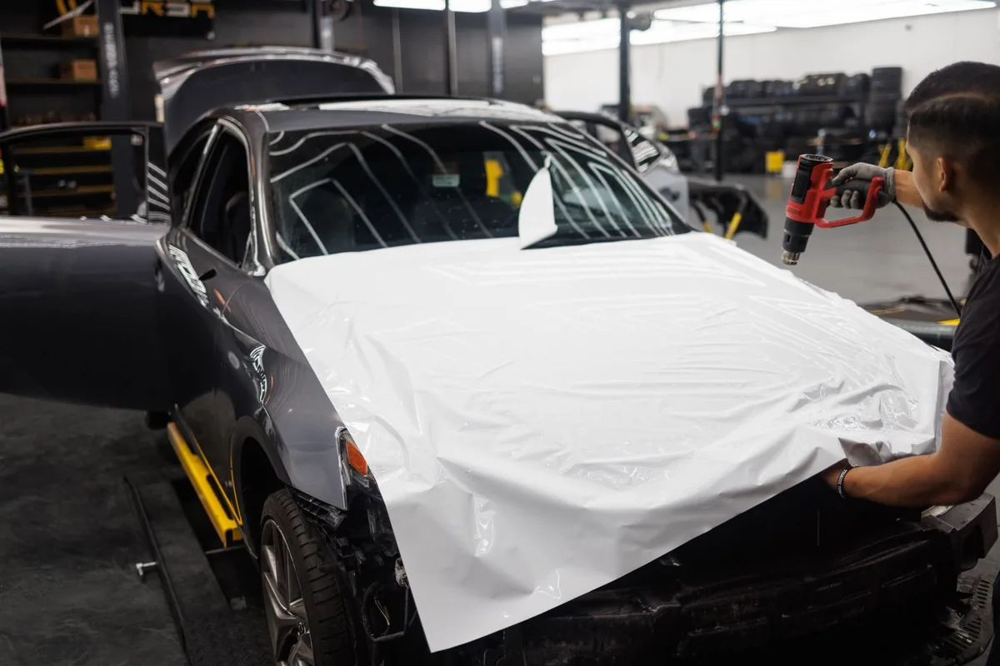
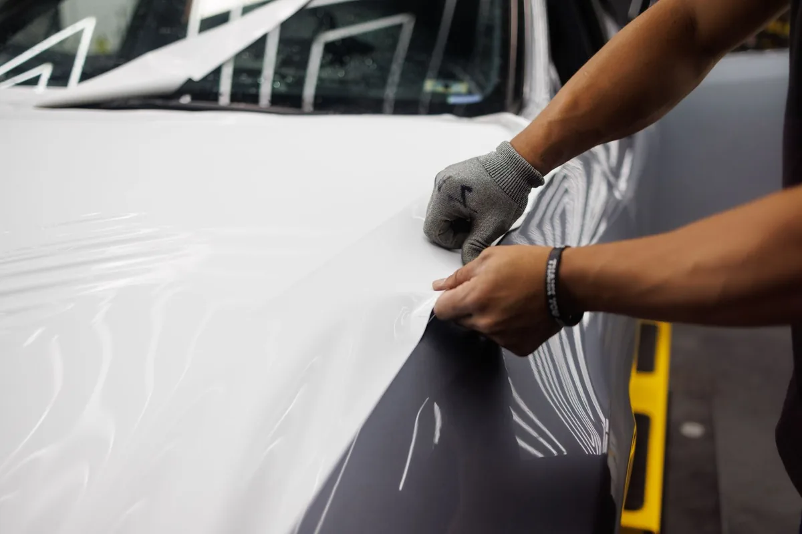

<strong>Direct answer:</strong> A typical sedan full wrap in the USA usually costs about $3,500, with a sample range of $2,500 to $5,500. Use the <a href="{{ '/car-wrap-cost-calculator/' | relative_url }}">Car Wrap Cost Calculator</a> to price your own car wrap.

All prices on this page are sample estimated USA ranges, not quotes. Your real price depends on your vehicle size, wrap type, vinyl brand, finish, and paint condition.

Car wrap cost is the same question in different words: how much does it cost to wrap a car, how much does it cost to wrap your car, how much does a car wrap cost, and how much does it cost to get your car wrapped all point to the same range, about $3,500 typical for a sedan full wrap, with a sample range of $2,500 to $5,500.

Key Takeaways

<ul>
<li>A typical sedan full wrap costs about $3,500, with a sample range of $2,500 to $5,500.</li>
<li>Typical full wrap prices are $2,800 for a compact, $3,500 for a sedan, $4,800 for an SUV, and $5,500 for a truck.</li>
<li>A chrome or color-shift wrap costs $6,000 to $10,000 or more, against $2,500 to $4,000 for a gloss sedan wrap.</li>
<li>A car wrap lasts about 5 to 7 years with care, and wrapping usually takes 3 to 5 days.</li>
<li>A wrap usually protects the paint underneath, and it is reversible, so it suits a color change you may want to undo.</li>
</ul>

<figure></figure>

Price table

## Car wrap cost by vehicle type

Film and labor rise with vehicle size. Larger vehicles need more vinyl and more labor hours, so size drives the price. So how much does it typically cost to wrap a car? For a sedan, a full wrap typically costs about $3,500, while a small car typically costs less and an SUV or truck typically costs more, as the table shows.

Swipe to see the Full wrap range column &rarr;

  

<table class="cost-table">

<thead>
<tr><th>Vehicle type</th><th>Full wrap range</th></tr>
</thead>
<tbody>
<tr><td>Small car</td><td>$1,800 to $2,500</td></tr>
<tr><td>Hatchback</td><td>$2,800 to $3,500</td></tr>
<tr><td>Sedan</td><td>$3,000 to $4,500</td></tr>
<tr><td>Small SUV</td><td>$3,200 to $4,500</td></tr>
<tr><td>Large SUV or sedan</td><td>$3,500 to $5,000</td></tr>
<tr><td>Pickup</td><td>$3,200 to $5,000</td></tr>
<tr><td>Luxury</td><td>$5,500 to $10,000</td></tr>
</tbody>
</table>

Our calculator uses $2,800 for a compact, $3,500 for a sedan, $4,800 for an SUV, and $5,500 for a truck at the typical level, which sits inside the ranges above. A truck wrap costs more than a compact car wrap with the same vinyl, because it needs more film and more time.

## Cost by finish

Gloss is the base price. Matte and satin add 5 to 20 percent, and chrome or color-shift film costs far more per square foot. Standard film costs $2.80 to $3.50 per sq ft, while chrome film costs $5 to $8 plus per sq ft. A car needs about 255 sq ft of film.

Color itself does not change the price much. How much does it cost to wrap a car black? In gloss, the same as any solid color wrap, a sedan $2,500 to $4,000. What changes the price is the finish, not the color, so a black matte wrap costs more than a black gloss wrap, not because it is black but because it is matte.

Swipe to see the Price column &rarr;

  

<table class="cost-table">

<thead>
<tr><th>Finish</th><th>Price</th></tr>
</thead>
<tbody>
<tr><td>Gloss (base)</td><td>Sedan $2,500 to $4,000</td></tr>
<tr><td>Matte or satin</td><td>Gloss price plus 5 to 20 percent</td></tr>
<tr><td>Chrome or color-shift</td><td>$6,000 to $10,000 plus</td></tr>
</tbody>
</table>

A matte sedan full wrap works out to $3,500 times 1.125, which is $3,937.50, rounded to $3,940 typical, with a low of $2,810 and a high of $6,190. A chrome sedan full wrap works out to $3,500 times 1.85, which is $6,475, rounded to $6,480 typical, with a low of $4,630 and a high of $10,180. The chrome typical of $6,480 sits inside the $6,000 to $10,000 plus range.

## Itemized cost breakdown

Vinyl and labor together are most of the total. The table below is the breakdown for a typical sedan full wrap.

Swipe to see the High column &rarr;

  

<table class="cost-table">

<thead>
<tr><th>Item</th><th>Low</th><th>Typical</th><th>High</th></tr>
</thead>
<tbody>
<tr><td>Vinyl material</td><td>$1,100</td><td>$1,500</td><td>$2,400</td></tr>
<tr><td>Labor (2 installers, 3 to 5 days)</td><td>$1,100</td><td>$1,600</td><td>$2,500</td></tr>
<tr><td>Design and prep</td><td>$180</td><td>$250</td><td>$400</td></tr>
<tr><td>Supplies and finishing</td><td>$120</td><td>$150</td><td>$200</td></tr>
<tr class="total"><td>Totals</td><td>$2,500</td><td>$3,500</td><td>$5,500</td></tr>
</tbody>
</table>

Labor is for 2 installers over 3 to 5 days on a full wrap. A partial wrap takes 1 to 2 days, and a roof and hood only wrap takes about 1 day, so the labor falls with the coverage.

## Partial wrap prices

If you do not need a full wrap, price the panel you want. A full wrap covers the whole car, a partial wrap covers less, and roof and hood only is the smallest job.

Swipe to see the Price column &rarr;

  

<table class="cost-table">

<thead>
<tr><th>Partial wrap</th><th>Price</th></tr>
</thead>
<tbody>
<tr><td>Mirrors</td><td>About $200</td></tr>
<tr><td>Stripes</td><td>About $300</td></tr>
<tr><td>Chrome delete</td><td>About $350</td></tr>
<tr><td>Hood or roof</td><td>About $350</td></tr>
<tr><td>Hood, roof, and trunk</td><td>About $750</td></tr>
</tbody>
</table>

Coverage multipliers work the same way: a partial wrap is about 0.55 of a full wrap, and roof and hood only is about 0.35. On a $3,500 sedan full wrap, a partial wrap works out to about $1,925 and roof and hood only to about $1,225, before the panel prices above are applied.

## Hidden costs

Two costs catch buyers out: door jambs and removal of an old wrap. Both are priced apart from a standard full wrap quote.

Swipe to see the Price column &rarr;

  

<table class="cost-table">

<thead>
<tr><th>Extra</th><th>Price</th></tr>
</thead>
<tbody>
<tr><td>Door jambs</td><td>$300 to $600</td></tr>
<tr><td>Removal of an old wrap</td><td>$500 to $1,200</td></tr>
</tbody>
</table>

Ask whether door jambs, mirrors, and removal of an old wrap are included, with prices, before you agree to a quote. A quote that leaves out removal is not cheaper, it is incomplete.

## Cost per year by lifespan

A wrap that lasts longer costs less per year, even if the upfront price is the same. On the typical $3,500 sedan wrap, the cost is $1,167 a year over 3 years, $700 a year over 5 years, and $500 a year over 7 years.

Swipe to see the Cost per year column &rarr;

  

<table class="cost-table">

<thead>
<tr><th>Lifespan</th><th>Cost per year, $4,000 wrap</th><th>Cost per year, $3,500 wrap</th></tr>
</thead>
<tbody>
<tr><td>3 years</td><td>$1,333</td><td>$1,167</td></tr>
<tr><td>5 years</td><td>$800</td><td>$700</td></tr>
<tr><td>7 years</td><td>$571</td><td>$500</td></tr>
</tbody>
</table>

Math for the $3,500 wrap: $3,500 divided by 3 is $1,167 a year, $3,500 divided by 5 is $700 a year, and $3,500 divided by 7 is $500 a year. Care decides where in the 5 to 7 year range a wrap lands.

## Wrap vs paint vs paint protection film

Choose by how long you will keep the car and whether you want the change to be reversible. Paint protection film is a different product from a color wrap: it is a clear film that protects paint from rock chips, not a color change. Some cars get both, paint protection film on the hood, bumper, and mirrors, and a color wrap over the rest.

Swipe to see the Best for column &rarr;

  

<table class="cost-table">

<thead>
<tr><th>Option</th><th>Typical cost</th><th>Reversible</th><th>Best for</th></tr>
</thead>
<tbody>
<tr><td>Vinyl wrap</td><td>$2,000 to $10,000 plus</td><td>Yes</td><td>A color change you may want to undo</td></tr>
<tr><td>Repaint</td><td>$1,500 to $10,000 by quality</td><td>No</td><td>A car you plan to keep for many years</td></tr>
<tr><td>Paint protection film</td><td>$1,000 to $8,000</td><td>Yes</td><td>Protecting new or good paint</td></tr>
</tbody>
</table>

A repaint costs $1,500 to $10,000 by quality, and a standard repaint for a sedan costs about $3,500, the same as a sedan full wrap. Read the full comparison in <a href="{{ '/blog/how-much-does-it-cost-to-paint-a-car/' | relative_url }}">How Much Does It Cost to Paint a Car?</a> before you decide.

## Wrap and resale value

A wrap does not add resale value. Many buyers prefer factory paint and will discount a wrapped car, because they cannot check the paint underneath without removing the wrap. A well-kept wrap in a neutral color is the safest case, while a bubbling, lifting, or sun-faded wrap, or an unusual color, narrows the buyer pool. If you plan to sell within a few years, budget for removal of the old wrap at $500 to $1,200, or remove it before the sale so buyers can see the paint it protected.

## How long does a wrap last by film

Lifespan depends on the film and on where it sits. Vertical panels last longer than horizontal panels, which take more sun. 3M 2080 lasts up to 8 years on vertical surfaces and 3 years on horizontal surfaces, while Avery lasts up to 12 years in black and white, 10 years in colors, and 5 years in metallic. A car wrap lasts about 5 to 7 years with care. Hand wash only, wait a week before the first wash, and park out of the sun.

<aside class="pull-quote">

Money-saving tip

Choose a solid color instead of custom graphics, and fix paint chips before wrapping.

</aside>

## What affects the price

### Vehicle size

Larger vehicles use more vinyl and take longer to wrap, so size drives the price. A truck wrap costs more than a compact car wrap with the same vinyl.

### Wrap coverage

Full wraps cost most, partial wraps cost about half, and roof and hood only costs least. Decide how much of the car you want covered before you ask for a quote.

### Vinyl quality

Premium vinyl brands cost more and last longer than budget films. A better film also looks smoother and resists fading and peeling.

### Cast vs calendered vinyl

Cast vinyl is the pro standard for a full wrap. It is poured thin, stretches around curves and compound shapes without shrinking back, and is what most shops use when the wrap has to last years. Calendered vinyl costs less and suits flat panels and short-term jobs, but it is thicker and stiffer, so it can shrink, crack at the edges, and lift sooner on a curved car. If a quote looks far below the usual range, ask which film it includes, because the film type is often the reason.

### Paint condition

Dents, rust, and peeling paint must be fixed first, since vinyl shows flaws underneath. A wrap does not hide bad paint, and it can lift off damaged areas.

### Design complexity

Custom graphics and color changes take more design time than a single solid color. A printed design with logos costs more than a plain color wrap. A printed commercial wrap adds design time, proofing, and print production on top of the install, so it is priced apart from a plain color change.

### Where the shop is

Shop labor rates vary by city and cost of living, the same way any skilled trade does. A shop in a major metro market usually quotes higher labor than a shop in a smaller market for the same job, even with the same film. Compare quotes from shops near you, and treat a quote far below the local range as a warning sign, not a bargain.

## What is included and what is not included

<h3>What is included</h3>
<ul class="checklist">
<li>Vinyl material</li>
<li>Labor, 2 installers, 3 to 5 days on a full wrap</li>
<li>Basic design and prep</li>
<li>Supplies and finishing</li>
</ul>

<h3>What is not included</h3>
<ul class="checklist checklist-x">
<li>Paint repair</li>
<li>Custom design work</li>
<li>Removal of an old wrap, $500 to $1,200</li>
<li>Door jambs, $300 to $600</li>
<li>Ceramic coating</li>
</ul>

## How to save money

<ul class="checklist">
<li><strong>Choose a solid color instead of custom graphics.</strong> Custom graphics and printed designs cost more than a plain color wrap.</li>
<li><strong>Fix paint chips before wrapping.</strong> Vinyl shows flaws underneath, so a small repair first saves a rewrap later.</li>
<li><strong>Compare vinyl brands, not just totals.</strong> A premium film costs more and lasts longer, so compare the film series and the warranty, not just the price.</li>
<li><strong>Wrap in the off season when shops are quieter.</strong> Shops with open dates are often more flexible on price.</li>
<li><strong>Start with a partial wrap if the budget is tight.</strong> Mirrors at about $200 or a hood or roof at about $350 change the look for far less than a full wrap.</li>
</ul>

## DIY wrap vs a pro shop

Wrapping a car in vinyl yourself costs less in cash and far more in time and risk. Standard film costs $2.80 to $3.50 per sq ft, and a car needs about 255 sq ft of film, before tools, prep, and the days the job takes. You also need a heat gun, a squeegee set, slip solution, and knifeless tape for trimming, and first-timers waste far more film than a pro shop, so buy more than the job should need. A pro shop takes 3 to 5 days for a full wrap, and it includes prep, design, and a warranty on the work. DIY film bubbles, lifts, and shows every flaw in the paint underneath, and a bad DIY job can cost more to strip and redo than the pro price. If you want to try it yourself, start with one panel, a roof or a hood, and build skill there before you commit to a full car.

<figure></figure>

## How to hire a wrap shop

If you want to know how much it costs to get a car wrap from a pro shop, price your own wrap first with the Car Wrap Cost Calculator, then get 3 written quotes for the same vehicle, coverage, and finish, and compare them line by line.

<ol class="steps">
<li><strong>Ask the shop to inspect the paint first.</strong> Dents, rust, and peeling paint must be fixed before wrapping, so get any repair listed in writing.</li>
<li><strong>Get 3 written quotes.</strong> Ask each shop to list the vinyl brand, film series, finish, design, and prep work separately, for the same vehicle and coverage.</li>
<li><strong>Ask about door jambs, mirrors, and removal.</strong> Confirm whether door jambs at $300 to $600 and removal of an old wrap at $500 to $1,200 are included, with prices.</li>
<li><strong>Check the shop portfolio for your finish.</strong> Matte and chrome show flaws more than gloss, so look at recent jobs in the finish you want.</li>
<li><strong>Ask how long the film warranty lasts.</strong> Get the warranty on vertical and horizontal panels in writing, because horizontal panels last less long in the sun.</li>
<li><strong>Ask how to wash and care for the wrap.</strong> Confirm when the first wash is safe, and get the care steps in writing before you drive away.</li>
</ol>

## Wrap care after install

Wait a week before the first wash, then hand wash only. Park out of the sun where you can, because horizontal panels take more sun and wear faster. Wash off bird droppings, bugs, and road salt promptly, and skip automatic car washes with stiff brushes. A wrap that is washed gently and kept out of harsh sun lasts closer to 7 years than to 5, which cuts the cost per year from $700 to $500 on a $3,500 wrap.

## How the calculator estimates your wrap

The calculator prices a wrap in three steps. Start with the vehicle base: $2,800 compact, $3,500 sedan, $4,800 SUV, $5,500 truck. Multiply by the coverage multiplier, 1.0 for a full wrap, 0.55 for a partial wrap, and 0.35 for roof and hood only, then by the finish multiplier, 1.0 for gloss, 1.125 for matte or satin, and 1.85 for chrome or color-shift. At the default sedan full gloss wrap that is $3,500 times 1.0 times 1.0, which is $3,500. Low is 71.4 percent of typical and high is 157.1 percent, so $3,500 gives $2,500 low and $5,500 high after rounding to the nearest $10. Your final price depends on vinyl brand, paint condition, and the shop, so always confirm the price in writing before work starts.

## How shops build a wrap quote

Most pro shops price a wrap with the same formula: the square feet of film the job needs, times the film cost per square foot, times a multiplier for the brand and finish, plus labor hours times the shop labor rate. A full wrap takes a two-person crew 3 to 5 days, and the time rises with body complexity and how much the shop takes apart, mirrors, trim, and door handles, for a clean edge-to-edge finish. Prep comes first and is part of the labor: a full wash and decontamination, then an alcohol wipe panel by panel before any film goes down. A shop that skips prep to save time is skipping the step that decides whether the wrap still looks clean in a year or starts lifting at the edges. When you compare quotes, ask each shop for an itemized quote that lists coverage, film brand and series, labor hours, and prep, so you compare the same job, not just the same total.

## Worked example: a full wrap with extras

The headline wrap price is rarely the final bill, because door jambs, old wrap removal, and chrome delete are priced apart. Here is a full job built from the figures on this page, using the low end of each extra. A professional full sedan wrap costs $3,500. Removal of an old wrap at the low end costs $500. Door jambs at the low end cost $300. A chrome delete costs about $350. The total is $3,500 plus $500 plus $300 plus $350, which is $4,650. The extras add $1,150 to the $3,500 headline price, which is about 33 percent more. At the high end of the extras, removal at $1,200 and door jambs at $600 would add $1,800 plus the $350 chrome delete, for $5,650 in total. Ask each shop to list every extra in writing, so the headline price and the final bill match.

## Cost per month: the real price of a wrap

A wrap is easier to judge by the month than by the total. On the typical $3,500 sedan wrap, the cost is about $97 a month over 3 years, about $58 a month over 5 years, and about $42 a month over 7 years. A $4,000 wrap works out to about $111 a month over 3 years, $67 a month over 5 years, and $48 a month over 7 years. The monthly math favors the longer lasting wrap, even when the upfront price is higher: a $4,000 wrap that lasts 5 years costs $67 a month, while a $3,500 wrap that lasts only 3 years costs $97 a month. Film quality, prep, installation, warranty, and expected service life all belong in the comparison, not just the quote.

## Body complexity: why some cars cost more to wrap

Vehicle size matters, but body complexity can matter almost as much. Large, flat panels are comparatively straightforward to wrap. Deep bumper openings, spoilers, mirrors, flares, antennas, sunroofs, sharp creases, and recessed sections all add installation time. That is why a small car with difficult bodywork can sometimes cost as much to wrap as a physically larger sedan. When you check a shop portfolio, look closely at bumpers, mirrors, panel edges, handles, spoilers, and recesses, because large flat door panels are much easier to make look good. Ask the shop how it handles badges, handles, mirrors, lights, trim, and bumpers, and whether disassembly is included in the quote or priced apart.

## Frequently asked questions

How long does a car wrap last?

A car wrap lasts about 5 to 7 years with care. Hand wash only, wait a week before the first wash, and park out of the sun to help it last.

Does a wrap damage paint?

No, a wrap usually protects the paint underneath. It does not hide bad paint, and it can lift off damaged areas, so fix dents, rust, and peeling paint first.

Can I wrap a leased car?

Often yes, you can wrap a leased car, but check your lease first. A wrap is reversible, so it suits a leased car when the lease allows it.

How long does wrapping take?

Wrapping usually takes 3 to 5 days for a full wrap. A partial wrap takes 1 to 2 days, and a roof and hood only wrap takes about 1 day.

How much does a chrome or color-shift wrap cost?

A chrome or color-shift wrap costs $6,000 to $10,000 or more, against $2,500 to $4,000 for a gloss sedan wrap. A chrome sedan full wrap works out to about $6,480 typical.

How much does a partial wrap cost?

Mirrors cost about $200, stripes about $300, a chrome delete about $350, a hood or roof about $350, and a hood, roof, and trunk about $750.

Should I wrap or paint my car?

A wrap is cheaper and reversible, paint lasts longer. A sedan full wrap costs about $3,500, while a repaint costs $1,500 to $10,000 by quality, so a wrap suits a color change you may want to undo, and paint suits a car you plan to keep for many years.

How much does a car wrap cost per month?

On a $3,500 sedan wrap, about $97 a month over 3 years, about $58 a month over 5 years, and about $42 a month over 7 years.

How much does it cost to wrap your car?

A typical sedan full wrap costs about $3,500, with a sample range of $2,500 to $5,500. A compact costs $2,800 typical, an SUV $4,800, and a truck $5,500.

How much does a car wrap cost?

Car wrap cost for a typical sedan full wrap is about $3,500, with a sample range of $2,500 to $5,500. A partial wrap costs about 0.55 of a full wrap, so about $1,925 on a $3,500 sedan wrap, and roof and hood only costs about 0.35, so about $1,225.

How much does it cost to get your car wrapped?

Getting your car wrapped costs about $3,500 typical for a sedan full wrap, with a sample range of $2,500 to $5,500. Chrome or color-shift wraps cost more, at $6,000 to $10,000 or more.

How much does it cost to vinyl wrap a car?

The cost to vinyl wrap a car is about $3,500 typical for a sedan full wrap, with a sample range of $2,500 to $5,500. Standard film costs $2.80 to $3.50 per sq ft, and a car needs about 255 sq ft of film.

How much does it cost to wrap a car hood?

A hood or roof wrap costs about $350. A hood, roof, and trunk together cost about $750. A full wrap costs far more, about $3,500 typical for a sedan, so a hood wrap is the cheaper way to change the look.

How much does it cost to wrap a small car?

A small car full wrap costs $1,800 to $2,500. A compact costs $2,800 typical on our calculator, against $3,500 for a sedan, $4,800 for an SUV, and $5,500 for a truck.

How much does it cost to wrap a car yourself?

Standard film costs $2.80 to $3.50 per sq ft, and a car needs about 255 sq ft of film, before tools, prep, and the days the job takes. A DIY wrap costs less in cash than a pro shop and far more in time and risk, and a bad DIY job can cost more to strip and redo than the pro price.

How much does it cost to have a car wrapped?

Having a car wrapped by a pro shop costs about $3,500 typical for a sedan full wrap, with a sample range of $2,500 to $5,500. The price includes film, labor, prep, and design, and a full wrap takes 3 to 5 days.

Why do quotes for the same car differ?

Labor rate, film brand, finish, disassembly, prep, and city all move a quote. One shop may remove mirrors, badges, and handles and wrap the edges, while another wraps around them. Ask each shop for an itemized quote that lists coverage, film brand and series, labor, and prep, then compare the same job.

## References

Prices on this page are sample estimated USA ranges from the Car Wrap Cost Calculator, not quotes. Labor cost context comes from the US Bureau of Labor Statistics, and vinyl and supply prices from Home Depot and Lowes. All prices on this page are sample estimated USA ranges, not quotes.

<a href="https://www.bls.gov/" target="_blank" rel="noopener">US Bureau of Labor Statistics</a> labor cost data

<a href="https://www.homedepot.com/" target="_blank" rel="noopener">Home Depot</a> vinyl and supply prices

<a href="https://www.lowes.com/" target="_blank" rel="noopener">Lowes</a> vinyl and supply prices

## Related links

<svg aria-hidden="true" width="30" height="30" viewBox="0 0 24 24" fill="none" stroke="currentColor" stroke-width="1.8" stroke-linecap="round" stroke-linejoin="round"><path d="M4.5 11 6 7.2A2 2 0 0 1 7.9 6h8.2a2 2 0 0 1 1.9 1.2L19.5 11"/><rect x="3" y="11" width="18" height="5.5" rx="1.5"/><circle cx="7.5" cy="18" r="1.8"/><circle cx="16.5" cy="18" r="1.8"/></svg>

Car
<h3><a href="{{ '/car-wrap-cost-calculator/' | relative_url }}">Car Wrap Cost Calculator</a></h3>
$2,500 - $5,500
<a class="card-cta" href="{{ '/car-wrap-cost-calculator/' | relative_url }}">Calculate your price &rarr;</a>

<svg aria-hidden="true" width="30" height="30" viewBox="0 0 24 24" fill="none" stroke="currentColor" stroke-width="1.8" stroke-linecap="round" stroke-linejoin="round"><path d="M12 3s6 6.5 6 11a6 6 0 0 1-12 0c0-4.5 6-11 6-11z"/><path d="M9.5 14a2.5 2.5 0 0 0 2.5 2.5"/></svg>

Car
<h3><a href="{{ '/oil-change-cost-calculator/' | relative_url }}">Oil Change Cost Calculator</a></h3>
$45 - $140
<a class="card-cta" href="{{ '/oil-change-cost-calculator/' | relative_url }}">Calculate your price &rarr;</a>

<svg aria-hidden="true" width="30" height="30" viewBox="0 0 24 24" fill="none" stroke="currentColor" stroke-width="1.8" stroke-linecap="round" stroke-linejoin="round"><path d="M12 3s6 6.5 6 11a6 6 0 0 1-12 0c0-4.5 6-11 6-11z"/><path d="M9.5 14a2.5 2.5 0 0 0 2.5 2.5"/></svg>

Guide
<h3><a href="{{ '/blog/how-much-does-it-cost-to-paint-a-car/' | relative_url }}">How Much Does It Cost to Paint a Car?</a></h3>
$1,500 - $10,000
<a class="card-cta" href="{{ '/blog/how-much-does-it-cost-to-paint-a-car/' | relative_url }}">Read the guide &rarr;</a>

<ul class="chip-list">
  <li><a href="{{ '/blog/how-much-does-an-oil-change-cost/' | relative_url }}">How Much Does an Oil Change Cost? &rarr;</a></li>
  <li><a href="{{ '/tools/' | relative_url }}">All Cost Calculators &rarr;</a></li>
</ul>
