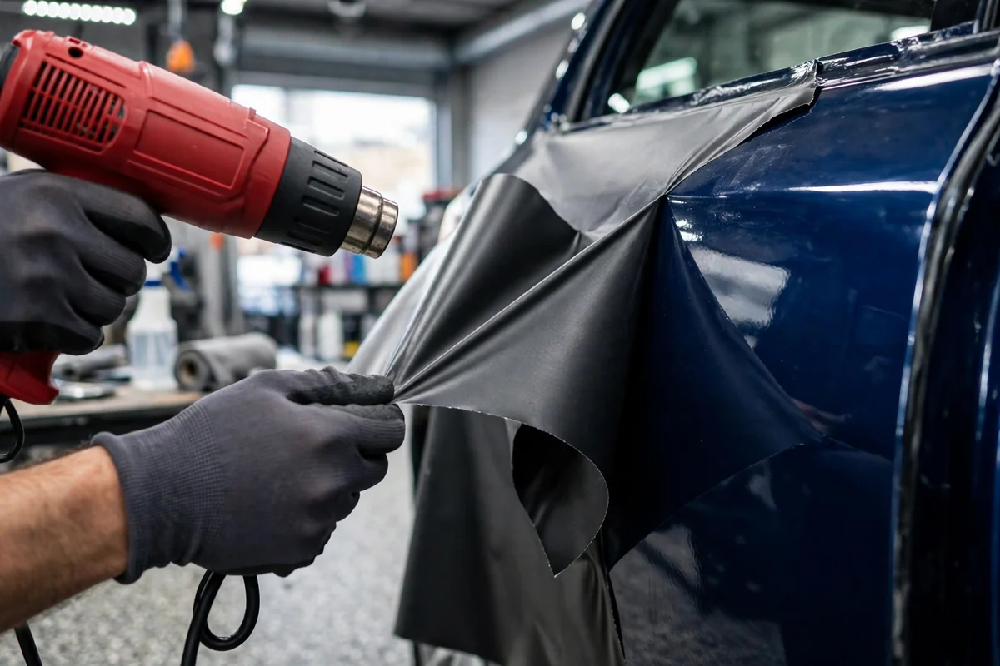
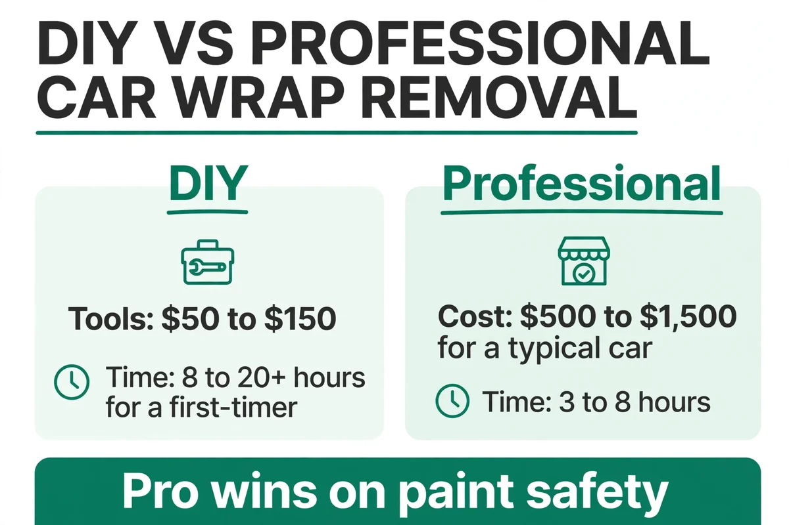
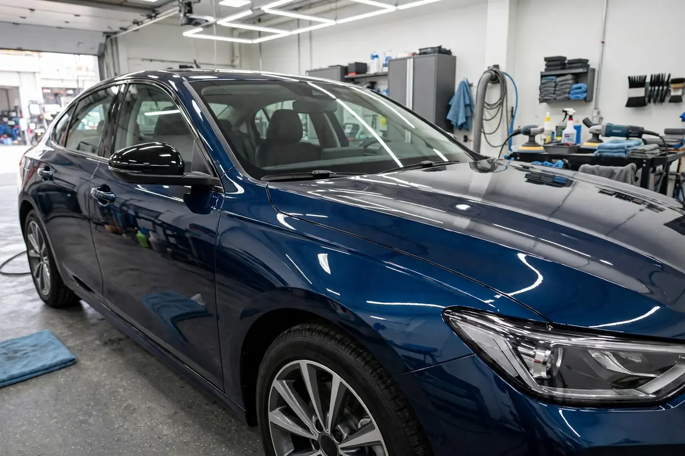

<strong>Direct answer:</strong> Professional removal of a full wrap on a typical car costs $500 to $1,500. <a href="https://www.autoblog.com/features/thinking-about-wrapping-your-car-heres-what-you-need-to-know-about-cost-and-care" target="_blank" rel="noopener">Autoblog</a> puts typical full-vehicle removal in the same range. A small car with a fresh wrap can cost as little as $300, while a wrap that is 5 or more years old, sun-baked, or chrome can cost $2,500 or more. The price is mostly labor: heat, peel, and clean, panel by panel.

All prices on this page are typical USA shop ranges, not quotes. Your real price depends on your vehicle size, wrap age, film type, and paint condition.

Removal is the part of a wrap that buyers forget to budget for. A new wrap is a big spend, so check <a href="{{ '/blog/how-much-does-a-car-wrap-cost/' | relative_url }}">how much does it cost to wrap a car</a> before you commit, then add removal to the total cost of owning the wrap. A wrap is reversible, which is one of its best selling points, but reversibility is not free. Somebody still has to heat every panel, peel the film without hurting the paint, and clean off the adhesive left behind.

This guide covers the full picture: one price matrix that combines vehicle size and wrap age, partial and per-panel prices, the DIY question answered honestly, what a quote should include, the rewrap discount, lease return timing, and what your paint will look like when the film comes off.

Key facts

<ul>
<li>A typical car costs $500 to $1,500 for professional wrap removal.</li>
<li>A fresh wrap under 3 years old costs $400 to $800 to remove, while a wrap 5 or more years old costs $1,000 to $2,500.</li>
<li>Per-panel removal costs $75 to $300, and a partial removal costs $200 to $600 on a car or sedan.</li>
<li>DIY tools cost $50 to $150, but a first-timer needs 8 to 20 hours or more, against 3 to 8 hours for a pro shop.</li>
<li>Removal is often discounted to $200 to $500 when the same shop installs the new wrap.</li>
</ul>

## Car wrap removal cost by vehicle size and wrap age

Two things decide your removal bill more than anything else: how big the vehicle is, and how old the wrap is. Age usually matters more. A fresh wrap peels off in large sheets. An old wrap turns brittle, cracks into small pieces, and leaves adhesive on every panel, which can double or triple the labor. The matrix below combines both factors in one place, which no wrap shop price page does.

Swipe to see the 5+ years column &rarr;

  

<table class="cost-table">

<thead>
<tr><th>Vehicle</th><th>Under 3 years</th><th>3 to 5 years</th><th>5+ years</th></tr>
</thead>
<tbody>
<tr><td>Compact</td><td>$300 to $450</td><td>$300 to $600</td><td>$600 to $1,000</td></tr>
<tr><td>Sedan or coupe</td><td>$500 to $700</td><td>$500 to $900</td><td>$900 to $1,500</td></tr>
<tr><td>SUV or pickup</td><td>$700 to $1,200</td><td>$700 to $2,000</td><td>$1,500 to $2,500</td></tr>
<tr><td>Cargo van</td><td>$800 to $1,300</td><td>$800 to $2,200</td><td>$1,800 to $2,500</td></tr>
<tr><td>High-roof Sprinter</td><td>$900 to $1,500</td><td>$900 to $2,500</td><td>$2,000 to $2,500</td></tr>
<tr><td>Box truck</td><td>$1,200 to $2,000</td><td>$1,200 to $3,500</td><td>$2,500 to $3,500</td></tr>
</tbody>
</table>

No shop publishes a cell-by-cell matrix, so each cell above combines the published vehicle-size range with the published wrap-age range. A fresh wrap prices near the low end of its vehicle range, a mid-age wrap spans the full vehicle range, and an old wrap starts at the top of the vehicle range and runs into the age range. Treat every cell as a typical range, not a quote. A wrap in suitable condition costs roughly $500 to $600 to remove, while a severely deteriorated wrap can cost more than $2,500.

Read the matrix by your row first, then your column. A sedan with a 2-year-old wrap sits in the $500 to $700 cell, while the same sedan with a 6-year-old sun-baked wrap sits in the $900 to $1,500 cell, and a chrome wrap of the same age can reach $1,200 to $2,500. The cheapest credible low end anywhere is $300, for a small car with a fresh wrap. The lesson is simple: remove a wrap before it passes 5 years, because every year past that point adds labor, and labor is the whole bill.

## Partial removal and per-panel prices

You do not always need the whole wrap off. Maybe only the hood film is failing, or you want the roof back to factory paint, or the door decals have to go before a sale. Partial removal is priced apart from a full removal, and it is the cheapest way to fix one bad area.

Swipe to see the Price column &rarr;

  

<table class="cost-table">

<thead>
<tr><th>Job</th><th>Price</th></tr>
</thead>
<tbody>
<tr><td>Car or sedan, partial wrap or decals</td><td>$200 to $600</td></tr>
<tr><td>SUV or pickup, partial wrap or decals</td><td>$250 to $800</td></tr>
<tr><td>Cargo van, partial wrap or decals</td><td>$300 to $900</td></tr>
<tr><td>High-roof Sprinter, partial wrap or decals</td><td>$350 to $1,000</td></tr>
<tr><td>Box truck, partial wrap or decals</td><td>$400 to $1,500</td></tr>
<tr><td>Per panel, any vehicle</td><td>$75 to $300</td></tr>
</tbody>
</table>

Per-panel prices depend on panel size: a mirror or a small trim piece sits near the low end, while a hood or a full door sits near the high end. No published price list breaks per-panel removal down by panel type, so ask the shop to price your exact panels.

One warning on partial removal: if the rest of the wrap has faded in the sun, the panel you uncover can look like a different color from the panels still wrapped. The paint under the removed panel was protected, while the film around it aged in the sun, so ask the shop what to expect before it starts.

## What affects the price

Removal is priced by time, and anything that adds time adds cost. Shops usually bill $75 to $150 per hour, so a job that takes twice as long costs roughly twice as much. These are the factors that move a quote up or down.

<ul>
<li><strong>Wrap age.</strong> The single biggest factor. A wrap under 3 years old usually peels in large sheets and costs $400 to $800 to remove. A wrap 3 to 5 years old costs $600 to $1,200. A wrap 5 or more years old costs $1,000 to $2,500, and a baked-in wrap can pass $2,500.</li>
<li><strong>Film type.</strong> Quality cast vinyl is made to come off cleanly. Cheap calendered or budget vinyl is thicker and stiffer, cracks at the edges, and leaves far more adhesive behind. Chrome and color-shift films are the hardest to remove, at $1,200 to $2,500.</li>
<li><strong>Sun and UV exposure.</strong> Sun breaks down vinyl and bonds the adhesive more firmly to the clear coat. A car parked outside in a sunny state ages its wrap far faster than a garaged car in a mild climate. The hood and the roof take the most sun and are usually the hardest to strip.</li>
<li><strong>Vehicle size and complexity.</strong> More surface means more film and more hours. Deep bumpers, spoilers, mirrors, flares, sharp creases, and recessed sections all slow the work, so a small car with difficult bodywork can cost as much to strip as a larger plain sedan.</li>
<li><strong>Paint condition.</strong> Sound factory paint releases film cleanly. Repainted panels, peeling clear coat, rust, and old body filler are risk points: film can lift weak paint as it comes off, and the shop charges more for the care and the cleanup.</li>
<li><strong>Region.</strong> Shop labor rates vary by city and cost of living, the same way any skilled trade does. No published price list gives a region-by-region table for removal, so compare quotes from shops near you and treat a quote far below the local range as a warning sign, not a bargain.</li>
</ul>

## How a pro shop removes a wrap

A pro removal is a patient job, not a fast one. The technician heats a section with a heat gun until the adhesive softens, lifts an edge with a plastic tool, and pulls the film back at a low angle while heating ahead of the peel. Panels come off one at a time, then the technician cleans the adhesive residue and wipes each panel down. A typical car takes 3 to 8 hours. A sedan with a wrap under 5 years old takes 3 to 5 hours, while a badly aged or chrome wrap can take 8 to 12 hours or more.

<figure></figure>

Heat is the whole technique. Too little heat and the film tears and leaves adhesive everywhere. Too much heat and the adhesive melts into the clear coat, or the paint itself is at risk. That is why a shop charges labor by the hour: the job cannot be rushed without making the cleanup longer.

## DIY vs pro removal

Removing a wrap yourself is possible, and on a fresh wrap it is not even hard. The question is whether the saving is worth the time and the paint risk. The table below puts the two options side by side.

Swipe to see the Pro shop column &rarr;

  

<table class="cost-table">

<thead>
<tr><th>Factor</th><th>DIY</th><th>Pro shop</th></tr>
</thead>
<tbody>
<tr><td>Cash cost</td><td>$50 to $150 for tools only</td><td>$500 to $1,500 for a typical car</td></tr>
<tr><td>Time, full car</td><td>8 to 20 hours or more for a first-timer</td><td>3 to 8 hours</td></tr>
<tr><td>Tools needed</td><td>Heat gun, plastic scrapers, adhesive remover, microfiber towels</td><td>Shop supplies included</td></tr>
<tr><td>Paint risk</td><td>Higher, especially on old film or repainted panels</td><td>Lower, and a good shop carries insurance</td></tr>
<tr><td>Cleanup</td><td>You do it, panel by panel</td><td>Included or itemized in the quote</td></tr>
<tr><td>Best for</td><td>Fresh wrap under about 2 years, good paint</td><td>Old, brittle, chrome, or sun-baked wraps</td></tr>
</tbody>
</table>

<figure></figure>

DIY tools cost $50 to $150 for a heat gun, plastic scrapers, adhesive remover, and towels. Some guides quote $40 to $80 for basic tools and $100 to $300 if you add a steamer or a polisher. The real cost is your weekend: a careful first-timer needs 8 to 20 hours or more on a full car, against 3 to 8 hours for a pro shop. Work panel by panel, heat before you pull, pull low and slow, and stop if the film starts coming off in tiny brittle pieces. That is the sign the wrap is too old for DIY.

The paint risk is what decides it for most people. On a fresh wrap over sound factory paint, DIY is low risk. On a wrap past 5 years, a chrome wrap, or any repainted panel, the film can lift paint as it comes off, and fixing that costs far more than the removal you saved. If you want to try it, start with one small panel, a mirror or a door, and judge the film and the paint there before you commit to the whole car.

## What a removal quote should include

A removal quote is only useful if you can see what is in it. The base price usually covers the vinyl peel itself. The extras are where bills grow, so ask about each one before you agree to a number.

Swipe to see the Typical extra cost column &rarr;

  

<table class="cost-table">

<thead>
<tr><th>Item</th><th>What to ask</th><th>Typical extra cost if not included</th></tr>
</thead>
<tbody>
<tr><td>Full vinyl peel</td><td>Is the whole wrap included, or only part of it?</td><td>Part of the base price</td></tr>
<tr><td>Adhesive residue cleanup</td><td>Is cleanup included, or billed apart?</td><td>$80 to $300</td></tr>
<tr><td>Light polish after removal</td><td>Is a polish included to even out the finish?</td><td>$75 to $200</td></tr>
<tr><td>Single-stage paint correction</td><td>Is correction included, or only a light polish?</td><td>$300 to $800</td></tr>
<tr><td>Disassembly, mirrors, handles, trim</td><td>Are parts removed and refitted, or worked around?</td><td>No standard figure, ask the shop</td></tr>
</tbody>
</table>

Adhesive cleanup is the biggest hidden cost, at $80 to $300, and it is often the line that separates a cheap quote from a complete one. A light polish at $75 to $200 clears haze and residue shadows and evens out the gloss after the film comes off. Single-stage paint correction at $300 to $800 is a bigger job for swirls and dullness, and it is priced apart from a polish. Get all three answers in writing, then compare quotes line by line instead of comparing totals.

## Remove and rewrap in one visit

If you are taking one wrap off to put another on, book both jobs with the same shop. Removal is often discounted to $200 to $500 when the same shop does the new wrap, because the car is already in the bay, the panels are already clean, and the shop keeps the whole job. That discount is not the same as free removal, and free removal is rare, so ask for the removal line in writing before you agree.

Before you pick the new film, price the new wrap with our <a href="{{ '/car-wrap-cost-calculator/' | relative_url }}">car wrap cost</a> calculator, then add the discounted removal on top. A sedan full wrap plus discounted removal is far cheaper as one booked job than as two separate visits.

## Lease return: remove the wrap before turn-in

A leased car has to go back the way it came, and that means the wrap comes off before turn-in. Book the removal a few weeks before your return date, not the week of it. Shops get busy, an old wrap can take longer than planned, and you need time for a polish or a paint check if the paint underneath needs attention.

If you return the car still wrapped, the leasing company can bill you for removal. No published figure exists for that bill, so do not guess at it and do not budget around it. The safe move is to remove the wrap at your own cost, keep the shop receipt, and photograph every panel after removal. Check your lease terms first, because some leases also require the car to be returned in its original color and condition, and a wrap that hid paint damage does not excuse the damage underneath.

## What the paint looks like after removal

Expect the paint to look different from the paint you remember, and do not panic. Two things are normal after a wrap comes off: ghosting, a faint outline where the wrap edges sat or where covered paint stayed a different shade from exposed paint, and uneven gloss, where some panels look shinier than others. Both come from years of the film shielding the paint in some places and not others. A light polish usually reduces both a lot, and it is the step most people skip and then regret.

<figure></figure>

What is not normal is paint coming off with the film, deep scratches the wrap was hiding, or clear coat peeling in sheets. Those point to weak or repainted paint underneath, and they are the reason a shop inspects the paint before it starts pulling film. If the paint underneath needs more than a polish, read <a href="{{ '/blog/how-much-does-it-cost-to-paint-a-car/' | relative_url }}">how much does it cost to paint a car</a> before you decide on a repaint, because a repaint costs $1,500 to $10,000 by quality and is a very different decision from a polish.

## How to get an exact quote

No price table can quote your car, because no two wraps age the same way. A shop needs four things to price your removal properly, so send all of them before you ask for a number.

<ol class="steps">
<li><strong>Photos of every side.</strong> Front, back, both sides, roof, and hood, in daylight. Close-ups of any lifting edges, bubbles, cracks, or faded areas help the shop judge the film.</li>
<li><strong>Wrap age and install date.</strong> When the wrap went on matters more than the car year. If you do not know the date, say so, and the shop will judge by the film condition.</li>
<li><strong>Film brand and type.</strong> Cast or calendered, gloss, matte, chrome, or color-shift, and the brand if you know it. Chrome and budget films change the price.</li>
<li><strong>Repainted panels.</strong> Tell the shop about any panel that was repainted or repaired before the wrap went on. Film can lift weak paint, and the shop needs to know before it starts.</li>
</ol>

Get 3 written quotes for the same job, and compare them line by line using the checklist above. A quote far below the rest usually leaves out adhesive cleanup or a polish, which means it is incomplete, not cheaper.

## Verdict

Budget $500 to $1,500 for professional removal of a full wrap on a typical car, less for a small car with a fresh wrap, and $2,500 or more for a large vehicle with a 5+ year sun-baked or chrome wrap. Remove the wrap before it passes 5 years, get the adhesive cleanup and polish priced in writing, and book lease removals weeks before turn-in. Removal is a labor bill, so the cheapest quote is rarely the complete one.

## Frequently asked questions

How much does it cost to remove a car wrap?

A typical car costs $500 to $1,500 for professional removal. A compact can cost as little as $300, while a sun-baked wrap that is 5 or more years old can cost $2,500 or more.

How long does it take to remove a car wrap?

A pro shop usually takes 3 to 8 hours for a typical car. A sedan with a wrap under 5 years old takes 3 to 5 hours, while a badly aged or chrome wrap can take 8 to 12 hours or more. A first-timer doing it at home should allow 8 to 20 hours or more.

Can I remove a car wrap myself?

Yes, if the wrap is under about 2 years old, the film is good quality, and the paint underneath is sound. Tools cost $50 to $150, and a first-timer should allow 8 to 20 hours or more. Leave old, brittle, or sun-baked wraps to a pro, because the paint risk is much higher.

Will removing a car wrap damage my paint?

Removal should not damage sound factory paint when it is done with heat and care. Risk rises on repainted panels, old or sun-baked film, and cheap calendered vinyl, which can lift weak paint or leave heavy adhesive behind.

How much does partial car wrap removal cost per panel?

Per-panel removal costs $75 to $300. A partial removal or decal removal on a car or sedan costs $200 to $600, and $250 to $800 on an SUV or pickup.

How much does it cost to remove a wrap from a leased car?

Removal itself costs the same as any car, typically $500 to $1,500, and you pay the shop directly. No published figure exists for what a leasing company bills if you return the car still wrapped, so remove it weeks before turn-in and keep the receipt.

What should a car wrap removal quote include?

A good quote lists the full vinyl peel, adhesive cleanup, and whether a light polish is included. Adhesive cleanup costs $80 to $300 if it is extra, a light polish costs $75 to $200, and single-stage paint correction costs $300 to $800.

How much does it cost to remove a wrap and rewrap a car?

When the same shop removes the old wrap and installs the new one, removal is often discounted to $200 to $500. You still pay the full price of the new wrap on top of that.

Is car wrap removal free with a new wrap?

Usually not. Some shops discount removal to $200 to $500 or fold it into a rewrap package, but free removal is rare, so ask for the removal line in writing before you agree.

Is PPF removal different from vinyl wrap removal?

Yes. Paint protection film is a different product from a vinyl color wrap, with thicker film and different adhesive, and shops price its removal separately. No standard published price range exists for PPF removal, so get a separate quote for it.

