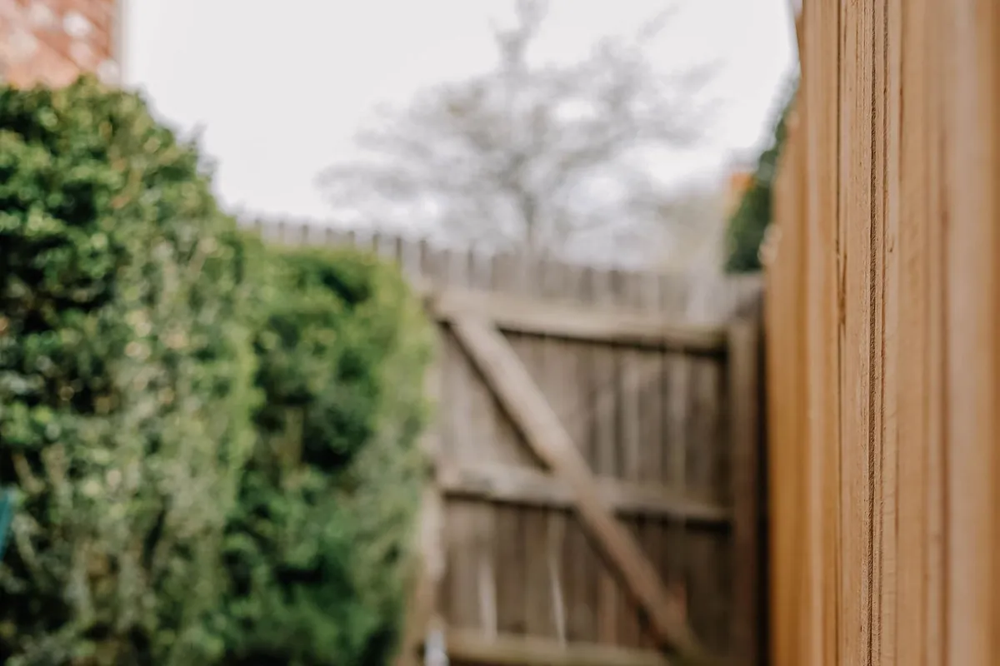
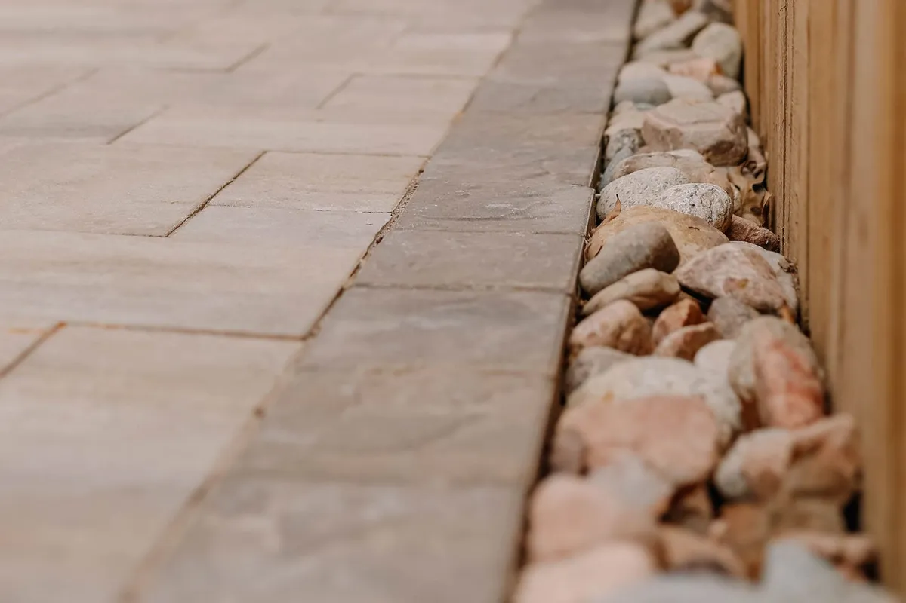

<strong>Direct answer:</strong> A professional fence staining job in the USA averages $1,700 to $1,900, with most homeowners spending $750 to $4,250. Per linear foot, staining costs $3 to $14 for one side. Doing it yourself costs far less: stain runs $20 to $50 per gallon, and a typical 150 ft fence needs 3 to 5 gallons for one side. <a href="https://www.angi.com/articles/cost-to-stain-a-fence.htm" target="_blank" rel="noopener">Angi</a> puts the national average at $1,900, while HomeAdvisor puts it at $1,700. If you are pricing a new fence as well, use the <a href="{{ '/fence-cost-calculator/' | relative_url }}">Fence Cost Calculator</a> to price the build itself.

All prices on this page are sample estimated USA ranges, not quotes. Your real price depends on your fence length, height, type, and condition, and on whether you stain one side or both.

Key Takeaways

<ul>
<li>A pro fence staining job averages $1,700 to $1,900, with most homeowners spending $750 to $4,250.</li>
<li>Staining costs $3 to $14 per linear foot for one side, or $1 to $3 per square foot.</li>
<li>Staining both sides adds about 80% to the one-side price, per Angi.</li>
<li>A 150 ft, 6 ft fence needs 3 to 5 gallons of stain for one side, at $20 to $50 per gallon.</li>
<li>Wait 6 to 8 weeks before staining a new fence, and expect stain to last 3 to 4 years before it needs a fresh coat.</li>
</ul>

<figure></figure>

Price table

## Fence staining cost by fence length

Length is the biggest price driver, because every extra foot needs more stain, more prep, and more labor. The table below shows one-coat prices from HomeAdvisor next to Angi's figures for the same lengths. A dash means that source does not list that length.

Swipe to see the Angi column &rarr;

  

<table class="cost-table">

<thead>
<tr><th>Fence length</th><th>HomeAdvisor, one coat</th><th>Angi</th></tr>
</thead>
<tbody>
<tr><td>50 ft</td><td>$150 to $700</td><td>-</td></tr>
<tr><td>100 ft</td><td>$300 to $1,400</td><td>-</td></tr>
<tr><td>110 ft</td><td>-</td><td>$550 to $1,300</td></tr>
<tr><td>150 ft</td><td>$450 to $2,100</td><td>-</td></tr>
<tr><td>180 ft</td><td>-</td><td>$850 to $2,200</td></tr>
<tr><td>200 ft</td><td>$600 to $2,800</td><td>-</td></tr>
<tr><td>300 ft</td><td>$900 to $4,200</td><td>$1,450 to $3,700</td></tr>
<tr><td>400 ft</td><td>$1,200 to $5,600</td><td>$2,000 to $4,800</td></tr>
<tr><td>600 ft</td><td>-</td><td>$2,900 to $7,400</td></tr>
</tbody>
</table>

HomeAdvisor prices are for applying a single coat. Angi prices are per its length table, updated September 23, 2026. Unlike many home projects, fence staining offers no volume discount: Angi notes the price per linear foot stays the same whether the fence is 20 ft or 200 ft.

Use the length table to place your own fence before you call a pro. A short 50 ft side fence is a few hundred dollars, while a 300 ft fence around a large yard runs into the thousands. The ranges above are for one side; staining both sides adds about 80%, per Angi, so a 150 ft fence at $450 to $2,100 for one side becomes roughly $810 to $3,780 for both sides.

## Cost per linear foot and per square foot

Pros quote fence staining two ways: per linear foot of fence, or per square foot of surface. Both describe the same job, and the table below shows what the three big cost guides publish, so you can check a quote in either unit.

Swipe to see the Project average column &rarr;

  

<table class="cost-table">

<thead>
<tr><th>Source</th><th>Per linear foot, one side</th><th>Per square foot</th><th>Project average</th></tr>
</thead>
<tbody>
<tr><td>Angi</td><td>$4 to $14</td><td>-</td><td>$1,900; most spend $1,400 to $2,200</td></tr>
<tr><td>HomeAdvisor</td><td>$3 to $14</td><td>$1 to $3</td><td>$1,700; most spend $750 to $4,250</td></tr>
<tr><td>Fixr</td><td>$2.25 to $10</td><td>$0.35 to $0.90</td><td>$2,000; range $1,000 to $4,000</td></tr>
</tbody>
</table>

Angi and HomeAdvisor figures are 2026 data. Fixr figures are from January 2025 and cover painting and staining together, which is why its per foot range runs lower. The three sources agree on the shape of the job: a typical pro project lands near $1,700 to $2,000, with a wide range around it.

To convert between the two units, multiply length by height to get square feet for one side. A 150 ft fence at 6 ft high is 900 sq ft for one side, or 1,800 sq ft for both sides. At $1 to $3 per square foot, per HomeAdvisor, one side is $900 to $2,700, which sits inside the $450 to $2,100 per-foot range at the low end and above it at the high end, because per square foot rates vary with prep and fence type. When a quote looks high, ask whether it is for one side or both, and how many coats it includes.

## Cost by fence type

The fence type sets how much surface a pro must cover and how fiddly the work is. Simple flat fences are cheapest to stain. Designs with boards on both faces, or with lattice and scrollwork, take far longer. <a href="https://www.homeadvisor.com/cost/painting/paint-stain-fence/" target="_blank" rel="noopener">HomeAdvisor</a> publishes these per linear foot ranges.

Swipe to see the Notes column &rarr;

  

<table class="cost-table">

<thead>
<tr><th>Fence type</th><th>Cost per linear foot</th><th>Notes</th></tr>
</thead>
<tbody>
<tr><td>Wood picket</td><td>$2 to $5</td><td>Short fences, usually 4 ft or less, so less surface</td></tr>
<tr><td>Privacy</td><td>$2 to $10</td><td>Tall solid boards, the most common stain job</td></tr>
<tr><td>Vinyl</td><td>$3 to $10</td><td>Painted rather than stained, since stain needs wood to soak into</td></tr>
<tr><td>Metal and aluminum</td><td>$4 to $10</td><td>Painted, not stained, and needs less prep than rusted iron</td></tr>
<tr><td>Shadow box</td><td>$4 to $14</td><td>Boards on both faces, the most labor heavy wood design</td></tr>
<tr><td>Wrought iron</td><td>$5 to $12</td><td>Rust removal and primer can add up to $1,250</td></tr>
</tbody>
</table>

Only wood fences can be stained, because stain needs to soak into the wood. Vinyl, metal, and wrought iron fences are painted instead, and Fixr prices painting and staining together at $2.25 to $10 per linear foot for one side.

## What drives the price

### Fence length and height

Length is the biggest driver, and height is second. A 6 ft fence has half as much surface again as a 4 ft fence of the same length, so it needs half as much stain again. Fixr puts a 4 ft fence at $2.25 to $3.50 per linear foot, a 6 ft fence at $3.25 to $5.75, and an 8 ft fence at $4.50 to $7.50. Measure the length with a tape or a measuring wheel, and note the height, before you ask for a quote, so every pro prices the same fence.

### Fence type and design

A flat privacy fence is the simplest stain job. A shadow box fence has boards on both faces, so the pro stains twice the surface on the same length, which is why it runs $4 to $14 per linear foot. Lattice tops and scrollwork add more edges and corners, and every edge takes brush time a sprayer cannot reach.

### Condition and prep

Prep is where cheap quotes and honest quotes part ways. A new fence needs a wash and a dry. A weathered fence needs cleaning, and a fence with old paint or flaking solid stain needs stripping or sanding first. HomeAdvisor puts pressure washing at $150 to $300 and fence repairs at $300 to $900, while Fixr puts pressure washing at $125 to $235. Angi notes prep can take a few hours to a few days depending on the fence length and condition. A quote that skips prep is not the same job as a quote that includes it.

### One side or both sides

Most fences sit on a property line, and only one side may be yours to stain. Staining both sides costs about 80% more than one side, per Angi, which is slightly less than double. HomeAdvisor recommends staining both sides when you can, because both faces need protection from weather. If the fence borders a neighbor, talk about splitting the cost of staining both sides.

### Number of coats

One coat of stain is usually enough, per HomeAdvisor, and two coats enhance durability and depth at extra material and labor cost. Paint is different: it needs a primer coat plus two coats of paint. If a quote includes two coats of stain, expect it to sit above the one-coat ranges in the length table.

### Location and season

Pros work best in cool, low-wind weather, per Angi, so regions with harsh winters or heavy rain have a shorter staining season, and that limited window can push labor prices up. Urban and coastal areas also run higher than rural areas for the same fence.

## DIY vs hiring a pro

Staining is one of the few fence jobs a homeowner can do well, because the skill is patience, not strength. The trade off is time: Angi says a pro takes 1 to 3 days on a typical fence, while HomeAdvisor says 3 to 5 days from cleaning to dry coats, and a DIY job can take a week or more on a large fence.

Swipe to see the Pro column &rarr;

  

<table class="cost-table">

<thead>
<tr><th>Item</th><th>DIY</th><th>Pro</th></tr>
</thead>
<tbody>
<tr><td>Stain</td><td>$20 to $50 per gallon</td><td>Included in the quote</td></tr>
<tr><td>Tools</td><td>Sprayer $60 to $250, or brushes $8 to $30</td><td>Included in the quote</td></tr>
<tr><td>Prep and supplies</td><td>Sealant $13 to $40, sandpaper $5 to $20</td><td>Included in the quote</td></tr>
<tr><td>Labor</td><td>Your time, a week or more on a large fence</td><td>$50 to $110 per hour (Angi) or $25 to $100 per hour (HomeAdvisor)</td></tr>
<tr><td>Typical total, 150 ft one side</td><td>About $140 to $560 with a sprayer</td><td>$450 to $2,100</td></tr>
</tbody>
</table>

Material prices are from Angi. Labor rates are from Angi and HomeAdvisor. The DIY total is built up in the worked example below, so you can see every line.

DIY suits a fence in fair condition with no repairs needed, and a homeowner who can give it two dry days in a row. Hire a pro if the fence needs repairs, stripping, or sanding, if it is over 6 ft, or if the boundary is shared and both sides need doing. Angi's advice for saving money is blunt: doing the prep work yourself, or the whole job yourself, is the number one way to cut the cost, because there is little room to negotiate material prices or labor rates.

## How much stain do you need

Buy the stain by the square foot, not by the fence. Measure the length, multiply by the height, and that is the surface for one side. Then divide by the coverage on the can.

A 150 ft fence at 6 ft high is 150 times 6, which is 900 sq ft for one side, or 1,800 sq ft for both sides. One gallon of stain covers 200 to 400 sq ft, per Angi. At 400 sq ft per gallon, 900 sq ft needs 2.25 gallons, and at 200 sq ft per gallon it needs 4.5 gallons, so buy 3 to 5 gallons for one side, and double it for both sides. Rough-sawn wood drinks more stain than smooth wood, so buy toward the high end for an old fence and toward the low end for smooth new boards.

At $20 to $50 per gallon, 3 to 5 gallons cost $60 to $250 for the stain alone. Add a sprayer at $60 to $250, or brushes at $8 to $30, plus sealant at $13 to $40 and sandpaper at $5 to $20, and the DIY total for one side of a 150 ft fence is about $140 to $560 with a sprayer, or about $90 to $340 with a brush. Many modern stains include built-in sealing, per Angi, so read the label before you buy a separate sealant.

## Worked example: a 150 ft wood privacy fence

Here is the same fence priced three ways, so you can see where the money goes. The fence is 150 ft long, 6 ft high, wood privacy, one side, in fair condition, with one coat of semi-transparent stain.

Swipe to see the Total column &rarr;

  

<table class="cost-table">

<thead>
<tr><th>Option</th><th>How the number is built</th><th>Total</th></tr>
</thead>
<tbody>
<tr><td>Pro, one side</td><td>HomeAdvisor length table for 150 ft, one coat</td><td>$450 to $2,100</td></tr>
<tr><td>Pro, one side, per foot check</td><td>Angi $4 to $14 per foot times 150 ft</td><td>$600 to $2,100</td></tr>
<tr><td>Pro, both sides</td><td>Fixr, 150 ft both sides</td><td>$675 to $3,000</td></tr>
<tr><td>DIY, one side, with sprayer</td><td>Stain $60 to $250, sprayer $60 to $250, sealant $13 to $40, sandpaper $5 to $20</td><td>About $140 to $560</td></tr>
<tr><td>DIY, one side, with brush</td><td>Stain $60 to $250, brushes $8 to $30, sealant $13 to $40, sandpaper $5 to $20</td><td>About $90 to $340</td></tr>
</tbody>
</table>

Arithmetic: pro per foot is 150 times $4 = $600 and 150 times $14 = $2,100. DIY with sprayer is $60 + $60 + $13 + $5 = $138 at the low end and $250 + $250 + $40 + $20 = $560 at the high end. DIY with brush is $60 + $8 + $13 + $5 = $86 at the low end and $250 + $30 + $40 + $20 = $340 at the high end. The national average for a pro job is $1,900 per Angi and $1,700 per HomeAdvisor, which sits near the top of the one-side range because many jobs include prep, both sides, or a second coat.

One more number is worth knowing if you are building a new fence rather than re-staining an old one. The Fence Cost Calculator prices a new fence, and its staining and sealing line is $90 to $240 at the 150 ft wood default, with $150 typical. That line is the stain and sealer for a new fence, not a standalone re-stain job, which is why it is lower than the pro re-stain ranges above: a re-stain adds prep, cleaning, and labor on an existing fence.

## Stain vs paint

Stain and paint both protect a wood fence, but they behave differently, and the choice changes the price and the upkeep. HomeAdvisor publishes this comparison.

Swipe to see the Paint column &rarr;

  

<table class="cost-table">

<thead>
<tr><th>Item</th><th>Stain</th><th>Paint</th></tr>
</thead>
<tbody>
<tr><td>Cost per gallon</td><td>$20 to $50</td><td>$20 to $80</td></tr>
<tr><td>Coats needed</td><td>Usually one</td><td>Primer plus two coats</td></tr>
<tr><td>Finish</td><td>Soaks in, shows the grain</td><td>Sits on top, hides the grain</td></tr>
<tr><td>How it ages</td><td>Fades, recoat on top of the old coat</td><td>Chips and peels, needs old paint removed first</td></tr>
<tr><td>How long it lasts</td><td>1 to 8 years (HomeAdvisor), 3 to 4 years (Fixr)</td><td>5 to 10 years (HomeAdvisor), 5 to 6 years (Fixr)</td></tr>
</tbody>
</table>

Paint lasts longer, but it costs more up front because of the primer and the extra coat, and recoating means stripping the old paint first. Stain is cheaper to apply and easier to refresh, which is why most wood fences are stained rather than painted. If you are pricing a full exterior paint job as well, read <a href="{{ '/blog/how-much-does-it-cost-to-paint-a-house/' | relative_url }}">how much it costs to paint a house</a>.

## When to stain a fence

Timing matters as much as price. A new fence needs about 6 to 8 weeks after installation before staining, per HomeAdvisor, so the wood dries and the stain soaks in properly. Staining too soon leaves the stain sitting on wet wood, where it peels instead of bonding.

For an existing fence, stain it when the old coat has faded or water no longer beads on the wood. Stain lasts 1 to 8 years, per HomeAdvisor, and Fixr puts it at 3 to 4 years, so plan on a fresh coat every few years rather than once in the life of the fence. A pro job takes 1 to 3 days, per Angi, or 3 to 5 days from cleaning to dry coats, per HomeAdvisor: clean the wood and let it dry for at least 24 hours, then allow 12 to 24 hours for each coat to dry. Pick cool, low-wind days, and check the forecast, because rain on a fresh coat ruins the finish.

## How to compare quotes and save money

<ul class="checklist">
<li><strong>Get 3 written quotes.</strong> Give every pro the same length, height, and type, and ask each one to list prep, stain, coats, and one side vs both sides separately.</li>
<li><strong>Check one side vs both sides.</strong> A quote for one side is not the same job as a quote for both sides, and both sides add about 80%, per Angi.</li>
<li><strong>Do the prep yourself.</strong> Cleaning the fence and clearing plants from the fence line before the crew arrives cuts paid labor time.</li>
<li><strong>Split it with a neighbor.</strong> Where the fence sits on a shared line and your neighbor agrees, splitting the cost can cut your bill in half.</li>
<li><strong>Buy the stain yourself only if the pro agrees.</strong> Some pros warranty their work only with the stain they supply, so ask before you buy.</li>
<li><strong>Stain before it gets bad.</strong> A faded fence needs more prep than a fence stained on schedule, so re-staining every few years is cheaper than waiting until the wood is grey and cracked.</li>
</ul>

<figure></figure>

## Frequently asked questions

How much does it cost to stain a fence per linear foot?

Staining a fence costs $3 to $14 per linear foot for one side, per HomeAdvisor, or $4 to $14 per linear foot, per Angi. Both sides roughly double the one-side price: Fixr puts both sides at $4.50 to $20 per linear foot.

How much does it cost to stain a 150 ft fence?

A pro charges $450 to $2,100 for one side of a 150 ft fence, per HomeAdvisor, with a national average near $1,900, per Angi. Both sides cost $675 to $3,000, per Fixr.

How much does it cost to stain a fence yourself?

Stain costs $20 to $50 per gallon, per Angi, and a 150 ft, 6 ft fence needs 3 to 5 gallons for one side, so the stain alone is $60 to $250. With a sprayer and supplies, a DIY job runs about $140 to $560.

How long does fence stain last?

Stain lasts 1 to 8 years, per HomeAdvisor, and Fixr puts it at 3 to 4 years. Paint lasts longer, at 5 to 10 years, per HomeAdvisor.

When should you stain a new fence?

Wait about 6 to 8 weeks after installation so the wood dries, per HomeAdvisor. Staining too soon stops the stain from soaking in properly.

Should you stain both sides of a fence?

Yes, stain both sides when you can, per HomeAdvisor. Both sides cost about 80% more than one side, per Angi, and the extra coat protects the wood from weather on both faces.

## References

Headline price ranges in this guide come from Angi, HomeAdvisor, and Fixr, checked live on November 27, 2026. All prices are sample estimated USA ranges, not quotes.

<a href="https://www.angi.com/articles/cost-to-stain-a-fence.htm" target="_blank" rel="noopener">Angi</a> fence staining cost, average and per linear foot

<a href="https://www.homeadvisor.com/cost/painting/paint-stain-fence/" target="_blank" rel="noopener">HomeAdvisor</a> fence painting and staining cost by length and type

<a href="https://www.fixr.com/costs/paint-fence" target="_blank" rel="noopener">Fixr</a> fence painting and staining cost per foot and per square foot

## Compare with other home projects

If you are pricing a full exterior refresh, read <a href="{{ '/blog/how-much-does-a-fence-cost/' | relative_url }}">how much a fence costs to install</a> and <a href="{{ '/blog/how-much-does-it-cost-to-replace-a-roof/' | relative_url }}">how much it costs to replace a roof</a>, and price the paintwork with the <a href="{{ '/house-painting-cost-calculator/' | relative_url }}">House Painting Cost Calculator</a>. If the fence is for a new home, see <a href="{{ '/blog/how-much-do-movers-cost/' | relative_url }}">how much movers cost</a>.

## Related links

<svg aria-hidden="true" width="30" height="30" viewBox="0 0 24 24" fill="none" stroke="currentColor" stroke-width="1.8" stroke-linecap="round" stroke-linejoin="round"><path d="M4 3v18M10 3v18M16 3v18M20 3v18"/><path d="M3 8h18M3 16h18"/></svg>

Home
<h3><a href="{{ '/fence-cost-calculator/' | relative_url }}">Fence Cost Calculator</a></h3>
$2,100 - $5,400
<a class="card-cta" href="{{ '/fence-cost-calculator/' | relative_url }}">Calculate your price &rarr;</a>

<svg aria-hidden="true" width="30" height="30" viewBox="0 0 24 24" fill="none" stroke="currentColor" stroke-width="1.8" stroke-linecap="round" stroke-linejoin="round"><path d="M2 12 12 3l10 9"/><path d="M6 10v10h12V10"/><path d="M9.5 14h2m2 0h2m-6 3h2m2 0h2"/></svg>

Guide
<h3><a href="{{ '/blog/how-much-does-a-fence-cost/' | relative_url }}">How Much Does a Fence Cost?</a></h3>
$3,000 - $7,500
<a class="card-cta" href="{{ '/blog/how-much-does-a-fence-cost/' | relative_url }}">Read the guide &rarr;</a>

<svg aria-hidden="true" width="30" height="30" viewBox="0 0 24 24" fill="none" stroke="currentColor" stroke-width="1.8" stroke-linecap="round" stroke-linejoin="round"><path d="M3 4h13v6H3z"/><path d="M16 7h2a2 2 0 0 1 2 2v2"/><path d="M18 11v7a2 2 0 0 1-2 2h-1a2 2 0 0 1-2-2v-4"/></svg>

Home
<h3><a href="{{ '/house-painting-cost-calculator/' | relative_url }}">House Painting Cost Calculator</a></h3>
$2,800 - $6,800
<a class="card-cta" href="{{ '/house-painting-cost-calculator/' | relative_url }}">Calculate your price &rarr;</a>

<svg aria-hidden="true" width="30" height="30" viewBox="0 0 24 24" fill="none" stroke="currentColor" stroke-width="1.8" stroke-linecap="round" stroke-linejoin="round"><path d="M2 12 12 3l10 9"/><path d="M6 10v10h12V10"/><path d="M9.5 14h2m2 0h2m-6 3h2m2 0h2"/></svg>

Guide
<h3><a href="{{ '/blog/how-much-does-it-cost-to-replace-a-roof/' | relative_url }}">How Much Does It Cost to Replace a Roof?</a></h3>
$7,528 - $11,475
<a class="card-cta" href="{{ '/blog/how-much-does-it-cost-to-replace-a-roof/' | relative_url }}">Read the guide &rarr;</a>

<ul class="chip-list">
  <li><a href="{{ '/tools/' | relative_url }}">All Cost Calculators &rarr;</a></li>
</ul>
